# 15 - STP / PVST+ Root Bridge Election

This one has been on my list for a while. My first attempt at an STP lab used Linux bridge nodes running mstpd in GNS3 Docker containers, and it never worked. The BPDUs crossed the links fine, but mstpd never updated any port roles and never wrote a log, which pointed at missing container capabilities. I parked it and moved on.

This time I rebuilt it on real Cisco IOS. Three Dynamips c2691 routers, each with an NM-16ESW EtherSwitch module, give me actual switchports running Cisco's PVST+. No containers, no capability issues.

The goal was to show four things:

1. How the root bridge gets elected when nothing is configured
2. How to split the root per VLAN so each VLAN uses a different path
3. That the same physical port can be blocking in one VLAN and forwarding in another
4. How long classic 802.1D actually takes to recover from a link failure

## Topology

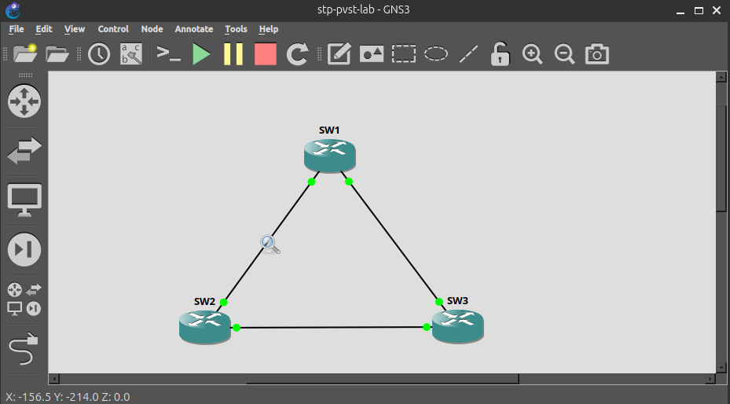

Three switches in a triangle, which gives STP a loop to break.

| Link | Ports |
|---|---|
| SW1 to SW2 | Fa1/0 to Fa1/0 |
| SW1 to SW3 | Fa1/1 to Fa1/0 |
| SW2 to SW3 | Fa1/1 to Fa1/1 |

All three links are 802.1Q trunks carrying VLAN 10 (USERS) and VLAN 20 (VOICE).

**Platform:** GNS3 with Dynamips, `c2691-adventerprisek9-mz.124-15.T14`, NM-16ESW in slot 1 of each router.

## Getting the VLANs to save

The first thing that broke was the VLAN database. Exiting `vlan database` threw this:

```
% not enough space on flash to store vlan database. trying squeeze...
% error squeezing flash - (No device available)
Error on database apply 40: NV storage failure
```

The c2691 template in GNS3 has no flash storage by default, and the EtherSwitch module needs somewhere to write `vlan.dat`. I stopped each router and set PCMCIA disk0 to 8 MB under Memories and disks. That changed the error to "Invalid DOS media", which meant the disk was there but had no filesystem yet. `erase flash:` didn't help. `format flash:` did. After that the VLANs applied normally.

Also worth knowing: on the EtherSwitch module you check VLANs with `show vlan-switch`, not `show vlan`.

## Base config

Same on all three switches apart from the hostname.

```
vlan database
 vlan 10 name USERS
 vlan 20 name VOICE
 exit
!
interface range fa1/0 - 1
 switchport mode trunk
 no shutdown
```

## 1. Default election

With every switch left at the default priority of 32768, the tie goes to the lowest MAC address. Dynamips hands out MACs by node order, so SW1 (`c0:01:...`) won root for both VLANs. All three switches agreed on the same root bridge ID, which also confirmed the EtherSwitch emulation was handling STP properly before I went any further.

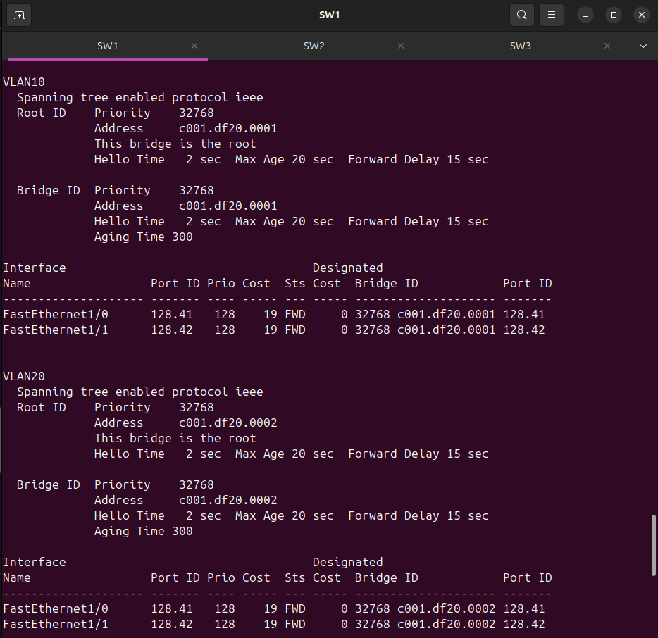
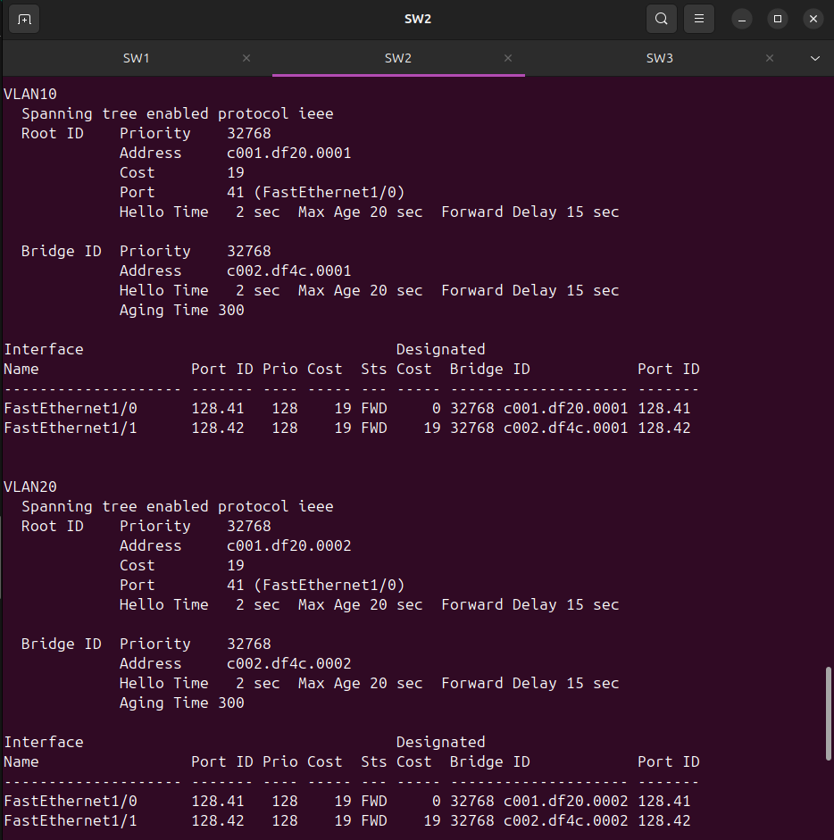
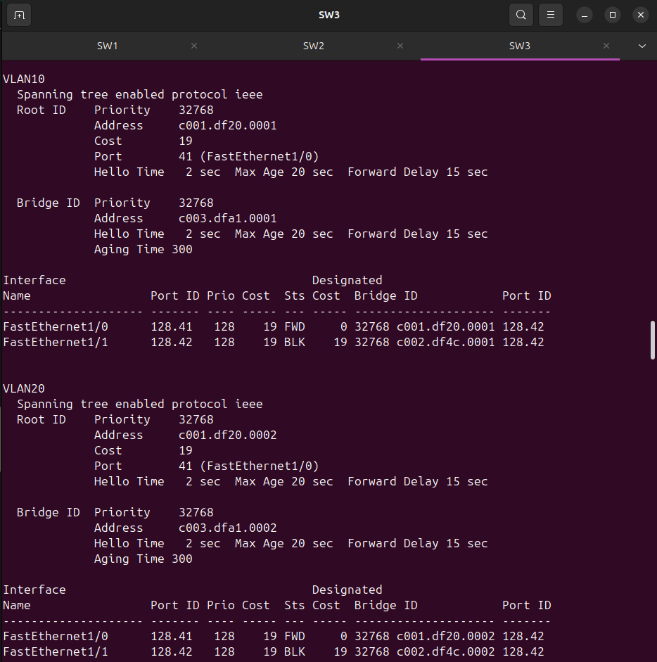

This is the problem with leaving STP alone. The root ends up wherever the lowest MAC happens to be, which in a real network is usually the oldest switch in the closet, not the one you'd actually want carrying traffic.

## 2. Splitting the root per VLAN

I made SW2 root for VLAN 10 and SW3 root for VLAN 20.

On SW2:
```
spanning-tree vlan 10 priority 0
```

On SW3:
```
spanning-tree vlan 20 priority 0
```

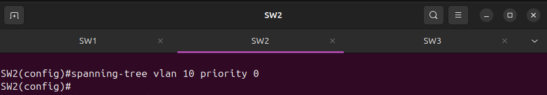
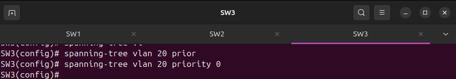

I used 0 so nothing could ever outrank them, including the physical 2950 if I add it later. In production I'd go with 4096 or 8192 (or `spanning-tree vlan 10 root primary`) and leave 0 free, so there's always room to move the root during a migration without touching the existing config.

## 3. Result

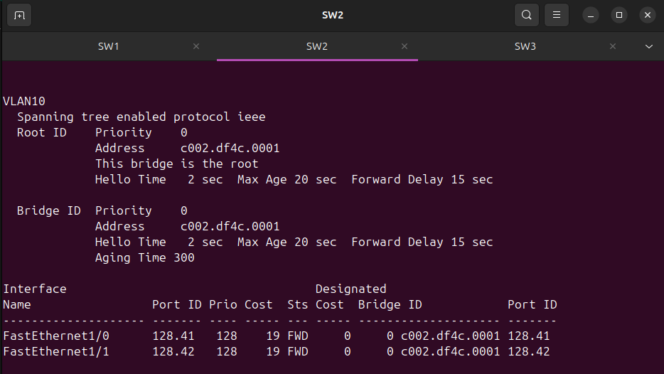
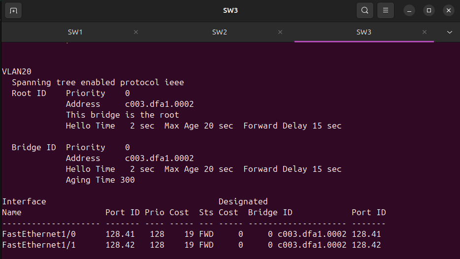

SW2 is now root for VLAN 10 and SW3 is root for VLAN 20. The priority shows as a plain 0 rather than 10 or 20, so this module doesn't use the extended system ID. Newer switches add the VLAN number to the priority, this one doesn't.

## 4. Same port, different state per VLAN

This is the part that actually shows PVST+ is doing its job.

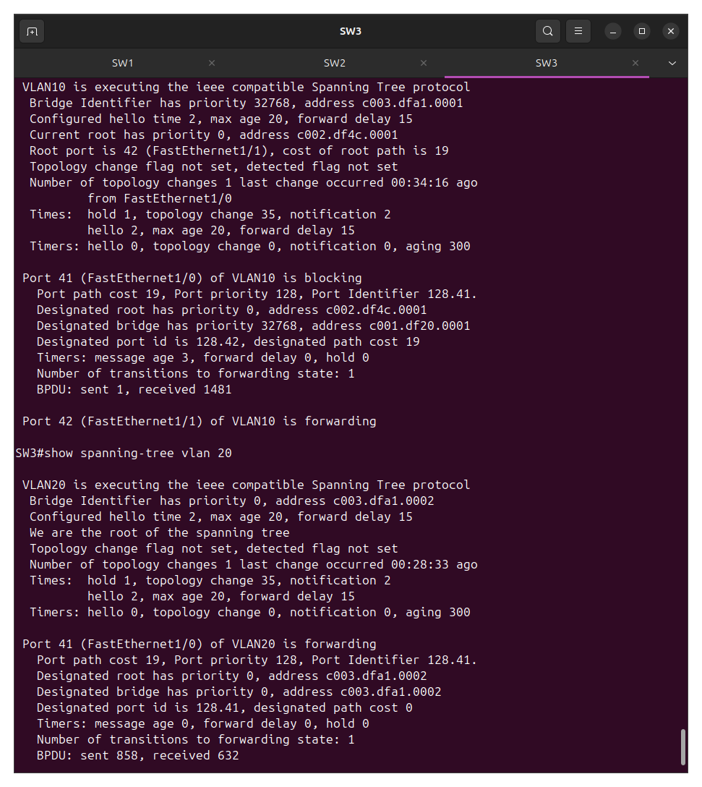

SW3 Fa1/0 (the link to SW1) is **blocking in VLAN 10** and **forwarding in VLAN 20**.

In VLAN 10, SW2 is root, so the loop gets broken on the SW1 to SW3 link. SW1 and SW3 both have a cost of 19 back to SW2, so the bridge ID breaks the tie. SW1 has the lower MAC, wins the designated port on that link, and SW3's end blocks.

In VLAN 20, SW3 is root, and a root bridge never blocks its own ports. So the same Fa1/0 forwards.

That means the SW1 to SW3 link isn't sitting idle. It carries VLAN 20 traffic while staying blocked for VLAN 10. With a single spanning tree for every VLAN (plain 802.1D or MST with one instance), one of these links would be doing nothing at all.

## 5. Failover

I shut SW3's VLAN 10 root port (Fa1/1, the direct link to SW2) and watched Fa1/0 take over. Before the shutdown, Fa1/1 was Root/FWD and Fa1/0 was BLK.

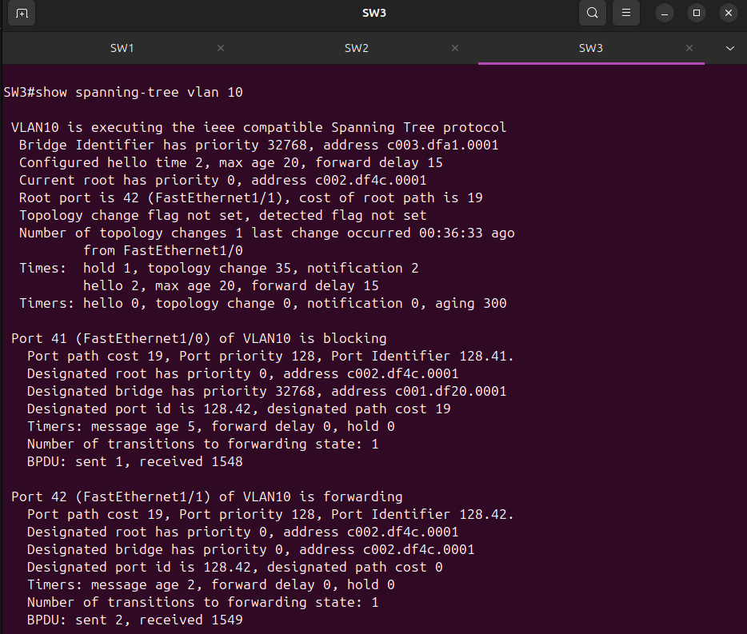

I turned on `debug spanning-tree events` and millisecond timestamps first so I could measure it.

```
*Mar  1 01:15:11.075: STP: VLAN10 Fa1/1 -> blocking
*Mar  1 01:15:11.075: STP: VLAN10 new root port Fa1/0, cost 38
*Mar  1 01:15:11.075: STP: VLAN10 Fa1/0 -> listening
*Mar  1 01:15:11.075: STP: VLAN20 Fa1/1 -> blocking
*Mar  1 01:15:13.075: STP: VLAN10 sent Topology Change Notice on Fa1/0
*Mar  1 01:15:26.083: STP: VLAN10 Fa1/0 -> learning
*Mar  1 01:15:41.091: STP: VLAN10 Fa1/0 -> forwarding
*Mar  1 01:15:59.487: STP: VLAN20 Topology Change rcvd on Fa1/0
```

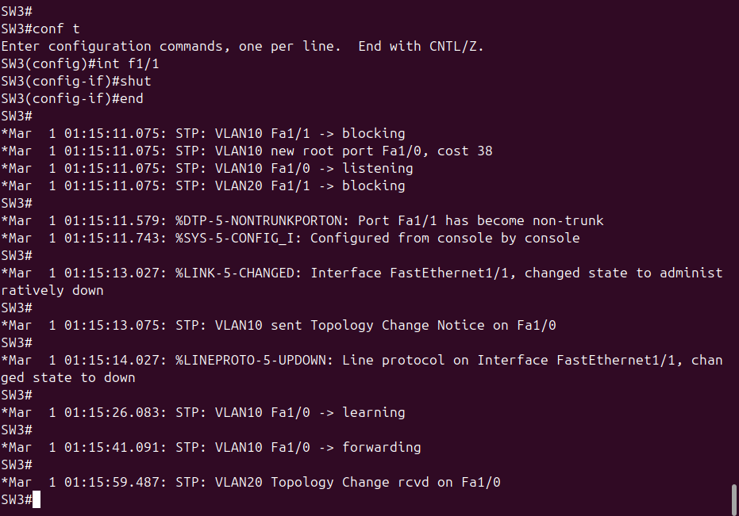

| Step | Time | Gap |
|---|---|---|
| Fa1/0 becomes root port, goes to listening | 01:15:11.075 | |
| Learning | 01:15:26.083 | 15.008s |
| Forwarding | 01:15:41.091 | 15.008s |
| **Total** | | **30.016s** |

Thirty seconds of no forwarding for VLAN 10 on SW3, which is two Forward Delay timers back to back. There was no Max Age wait because the failure was on a directly connected port, so SW3 knew straight away. If the break had been further away, SW3 would have had to wait up to 20 more seconds for the old BPDUs to age out first.

The new root port cost of 38 is the path through SW1 (19 + 19), compared to 19 on the direct link it lost.

VLAN 20 played out completely differently from the same link failure. SW3 is root for VLAN 20, so Fa1/1 just went down and SW3 had nothing to recalculate. The topology change it received later came from SW2, which lost its direct path to SW3 and had to reconverge on its own side.

After the dust settled, Fa1/0 was SW3's root port for VLAN 10. Bringing Fa1/1 back up reversed everything.

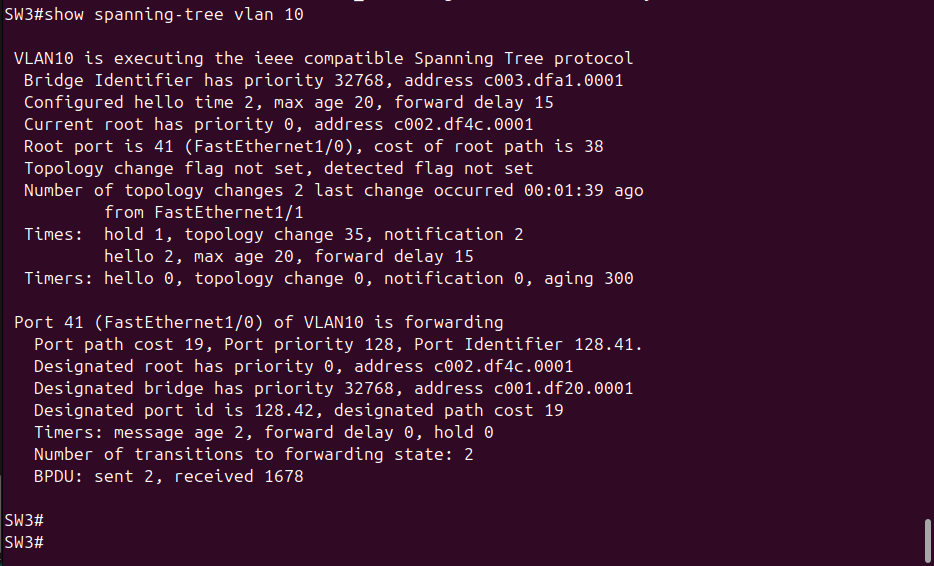

Thirty seconds is a long time for a voice call. Rapid PVST+ gets this down to around a second using proposal and agreement handshakes instead of timers, which is why nobody runs classic 802.1D anymore. I didn't test Rapid PVST+ here.

## 6. PVST+ BPDUs in Wireshark

I captured on the SW1 to SW2 link with an `stp` filter and got one BPDU per VLAN.

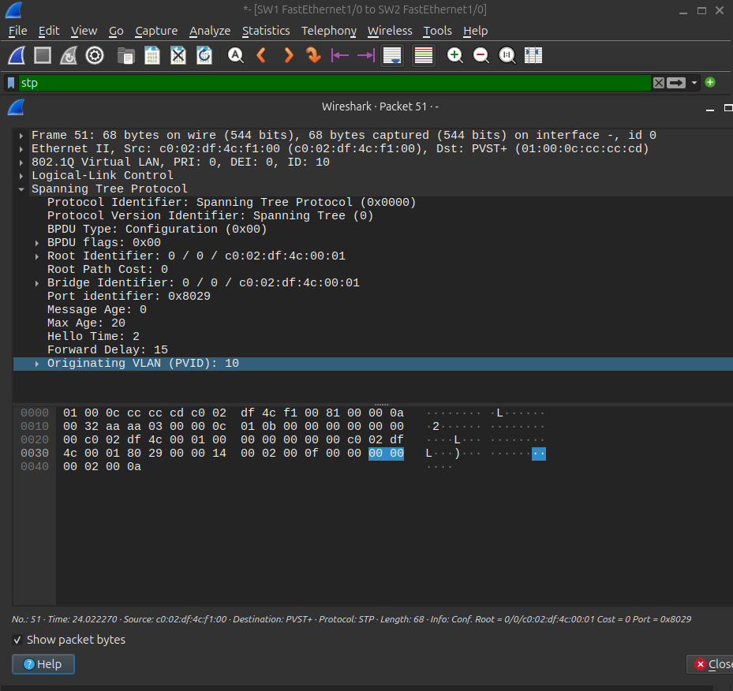
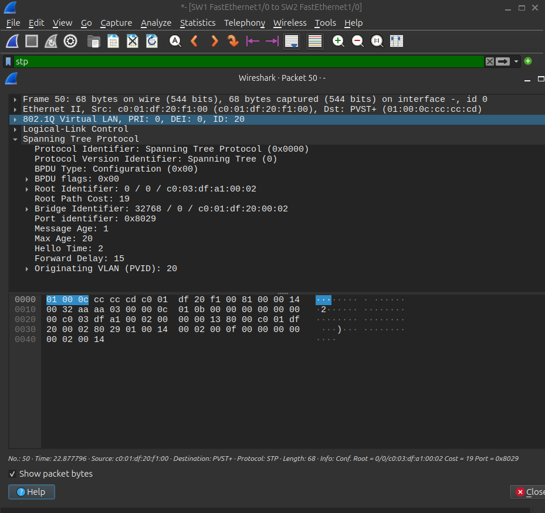

A few things in the VLAN 10 BPDU tell you this is PVST+ and not standard STP:

- The destination is `01:00:0c:cc:cc:cd`, Cisco's PVST+ address, not the IEEE `01:80:c2:00:00:00`
- The frame has an 802.1Q tag with VLAN ID 10
- There's an **Originating VLAN (PVID)** field at the end of the BPDU. Cisco adds that so switches can catch a native VLAN mismatch on a trunk

Root Identifier and Bridge Identifier are the same MAC with a root path cost of 0, so this BPDU came straight from the root bridge, SW2. The `0 / 0` in the root ID backs up the point about there being no extended system ID.

The timers line up with the failover test too. Protocol version 0 (classic, not rapid), Hello 2, Max Age 20, Forward Delay 15. That Forward Delay of 15 is exactly where the 30 seconds came from.

## What I'd do next

- Bring the physical 2950 in as a fourth switch through a GNS3 Cloud node and see how it fits into the election
- Try Rapid PVST+ and compare the convergence time against the 30 seconds here
- Add PortFast and BPDU Guard on edge ports
