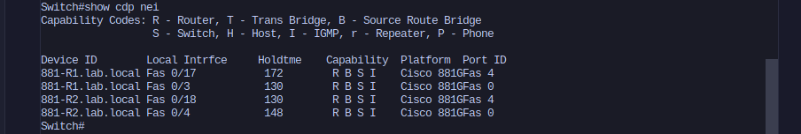
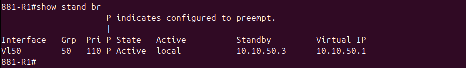
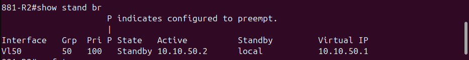
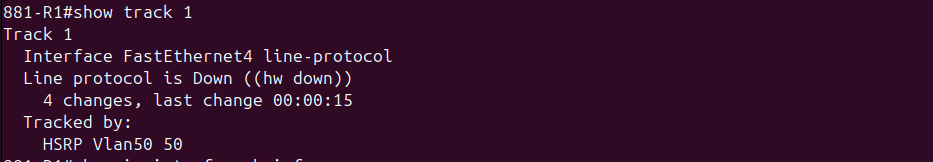
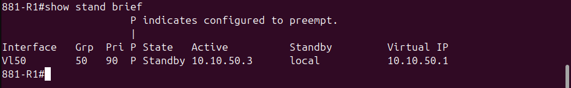
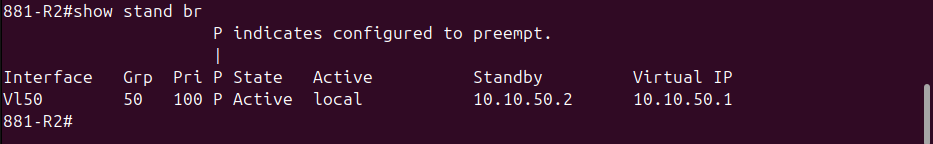
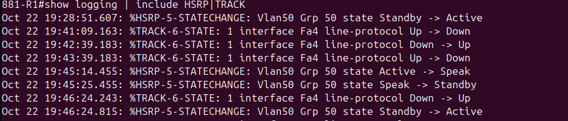
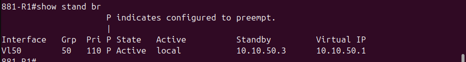
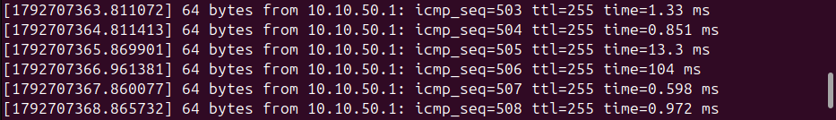
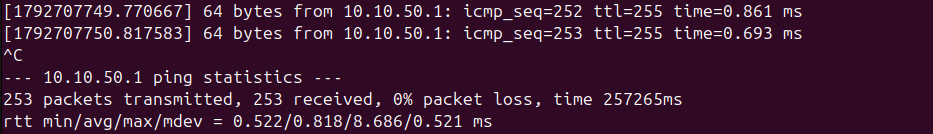

# 16 - HSRP on Physical Cisco 881 Routers

## Overview

This lab builds HSRP first-hop redundancy on two physical Cisco 881 routers, with interface tracking on each router's WAN port and a real cable-pull failover test. A Linux client on the Acer pings the virtual gateway the whole time, so the effect of each failover is measured from the client's point of view rather than assumed.

It is also the follow-up to `10-vrrp-fhrp`. That lab got VRRP electing a Master and Backup in GNS3 but never demonstrated a failover, because frames stopped crossing between the GNS3 Cloud nodes and the physical NICs. Moving the routers onto real hardware removed that problem entirely.

## Hardware

| Device | Details |
|---|---|
| 881-R1, 881-R2 | Cisco 881G (C881G+7-A-K9), IOS 15.7(3)M9, advipservices permanent license |
| Switch | Cisco Catalyst 2950 (c2950-i6q4l2-mz.121-22.EA2) |
| Client | Acer (Ubuntu 24.04), using an 802.1Q subinterface on its onboard NIC |

Both 881s were bought used. Before this lab, each one was wiped (`write erase`, `delete flash:vlan.dat`, `reload`) and given a baseline config: hostname, local user, SSH v2 only, and a management address in VLAN 1.

## Topology

```
                        2950
        Fa0/3 (trunk)  Fa0/4 (trunk)  Fa0/17 (VLAN 60)  Fa0/18 (VLAN 60)  Fa0/1 (trunk)
            |               |                |                 |                |
          FE0             FE0              FE4               FE4          enp1s0 / enp1s0.50
         881-R1         881-R2           881-R1            881-R2            Acer
```

- FE0 on each router is a switchport trunked to the 2950. It carries VLAN 1 (management) and VLAN 50 (the HSRP LAN).
- FE4 on each router is the routed WAN port, plugged into an access port in VLAN 60. This is the link R1 tracks and the cable that gets pulled.
- The Acer reaches VLAN 1 untagged and VLAN 50 tagged over the same cable, through `enp1s0.50`.

## Addressing

| Segment | VLAN | Subnet | 881-R1 | 881-R2 |
|---|---|---|---|---|
| Management | 1 | 10.10.30.0/24 | 10.10.30.21 | 10.10.30.22 |
| HSRP LAN | 50 | 10.10.50.0/24 | 10.10.50.2 | 10.10.50.3 |
| Virtual IP | 50 | 10.10.50.1 | | |
| WAN uplink | 60 | 10.10.60.0/24 | 10.10.60.2 | 10.10.60.3 |

The Acer client sits at 10.10.50.10 in VLAN 50.

## Configuration

### 881-R1

```
vlan 50
!
track 1 interface FastEthernet4 line-protocol
!
interface FastEthernet0
 switchport mode trunk
!
interface FastEthernet4
 ip address 10.10.60.2 255.255.255.0
 no shutdown
!
interface Vlan50
 ip address 10.10.50.2 255.255.255.0
 standby version 2
 standby 50 ip 10.10.50.1
 standby 50 priority 110
 standby 50 preempt
 standby 50 track 1 decrement 20
 no shutdown
```

### 881-R2

```
vlan 50
!
interface FastEthernet0
 switchport mode trunk
!
interface FastEthernet4
 ip address 10.10.60.3 255.255.255.0
 no shutdown
!
interface Vlan50
 ip address 10.10.50.3 255.255.255.0
 standby version 2
 standby 50 ip 10.10.50.1
 standby 50 preempt
 no shutdown
```

R2 keeps the default priority of 100 and does no tracking of its own.

### 2950

```
vlan 60
!
interface FastEthernet0/1
 switchport trunk allowed vlan add 50
!
interface range FastEthernet0/17 - 18
 switchport mode access
 switchport access vlan 60
```

Fa0/3 and Fa0/4 were already trunks and allowed VLANs 1 and 50.

### Acer client

The client is a NetworkManager VLAN connection, so the address survives link flaps and reboots:

```
sudo nmcli connection add type vlan con-name hsrp-client dev enp1s0 id 50 ipv4.method manual ipv4.addresses 10.10.50.10/24
sudo nmcli connection up hsrp-client
```

## How the failover works

R1 starts as Active with priority 110. Track 1 watches the line protocol on FE4. When FE4 goes down, HSRP subtracts 20 from R1's priority, leaving it at 90. R2 is at 100 and has preempt configured, so it takes over as Active. When FE4 comes back, R1 returns to 110, and because R1 also has preempt, it takes the Active role back.

## Verification

### Mapping the cables

With two identical routers it was easy to pull the wrong cable, so CDP on the 2950 was used to map every 881 port to its switch port before testing.



### Before the pull

R1 is Active at priority 110 and R2 is Standby at 100, both with preempt.





### During the outage

With R1's FE4 cable pulled, track 1 reports the line protocol as down.



R1 dropped to priority 90 and moved to Standby, and R2 became Active.





The router log shows the sequence: the track going down, the HSRP state change, and later R1 preempting back once FE4 was restored.



### After restoring FE4

R1 is back to Active at priority 110.



### Client impact

The client ran `ping -D -O 10.10.50.1` through two full pull-and-restore cycles. `-O` prints a line for every reply that doesn't arrive, so any loss is visible.

In the first run, one reply was lost (icmp_seq 456), with about two seconds between the last reply before the failover and the first one after it. When FE4 was restored, two replies came back slower than usual (13 ms and 104 ms against a normal 0.5 to 1 ms) but none were lost. That was R1 preempting back. The run ended at 514 of 515 received.




The second run lost nothing: 253 of 253 received, with a single 8.69 ms reply at the handover.



So across two runs, a tracked failover cost between zero and one ping, under two seconds in the worst case. Whether a ping is lost comes down to whether one happens to land in the short window while R1 steps down and the 2950 moves the virtual MAC to R2's port.

The client never had to re-ARP. The gateway MAC stayed at `00:00:0c:9f:f0:32` before and during the failover, which is the HSRPv2 virtual MAC for group 50 (0x032).


## Findings

**Tracking alone doesn't cause a failover.** The first cable pull dropped R1's priority to 90 exactly as configured, but R1 stayed Active. R2 had no preempt, and without it a Standby router never takes over from a working Active router, even one with a lower priority. It only steps in when the Active router actually disappears. Adding `standby 50 preempt` on R2 fixed it immediately. Preempt has to be on both sides: on R1 so it takes the role back after recovery, and on R2 so it can take over in the first place.

**A tracked failover is a handover, not an outage.** R1 is still alive when its priority drops, so it hands over cleanly and the switch learns the virtual MAC on R2's port almost immediately. A hard failure, such as R1 losing power, would be different: R2 would have to wait for R1's hellos to time out, which is 10 seconds with the default timers. That case was not tested here.

**Log messages don't show up over SSH by default.** The HSRP state changes appeared on the console but not in SSH sessions. `terminal monitor` turns them on for the current session, and `show logging` shows everything that was already logged.

## Setup issues along the way

- **FE4 stayed dark when first cabled.** After a wipe, routed ports on the 881 come up administratively shut down, while FE0 to FE3 are switchports and come up on their own. FE4 needed `no shutdown`.
- **FE3 is not a substitute for FE4.** FE0 to FE3 are switchports in VLAN 1 by default. Plugging one into a VLAN 60 access port would have joined the 2950's VLAN 1 and VLAN 60 inside each router, and with both routers cabled that way it would have created a loop.
- **The Acer kept losing its lab address.** An address added with `ip addr add` disappeared whenever the link flapped, because NetworkManager reapplied its saved profile for `enp1s0`. Adding the address to the profile with `nmcli connection modify` made it stick.
- **SSH to the 881s needed older algorithms.** Current OpenSSH refuses the key exchange and host key types this IOS version offers, so the client needs `-o KexAlgorithms=+diffie-hellman-group14-sha1 -o HostKeyAlgorithms=+ssh-rsa`.
- **One router's clock was ten years off.** R1's clock reported 2016 after boot. The 881 doesn't keep time across reloads here, so the clock was set by hand. NTP is the proper fix.

## Known gaps

- The hard-failure case (powering off R1 or pulling its LAN cable) was not tested, so the 10 second figure above comes from the default HSRP hold time, not a measurement.
- HSRP timers were left at their defaults.
