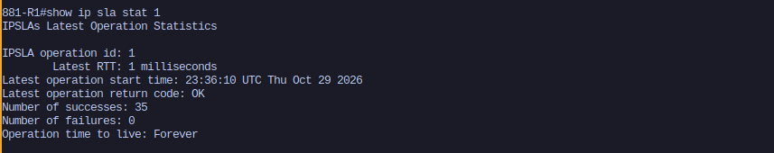
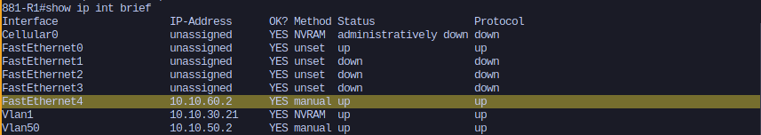
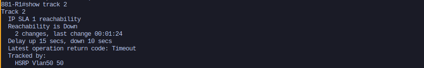
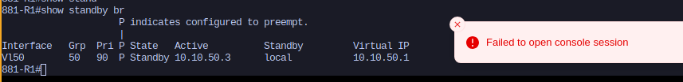
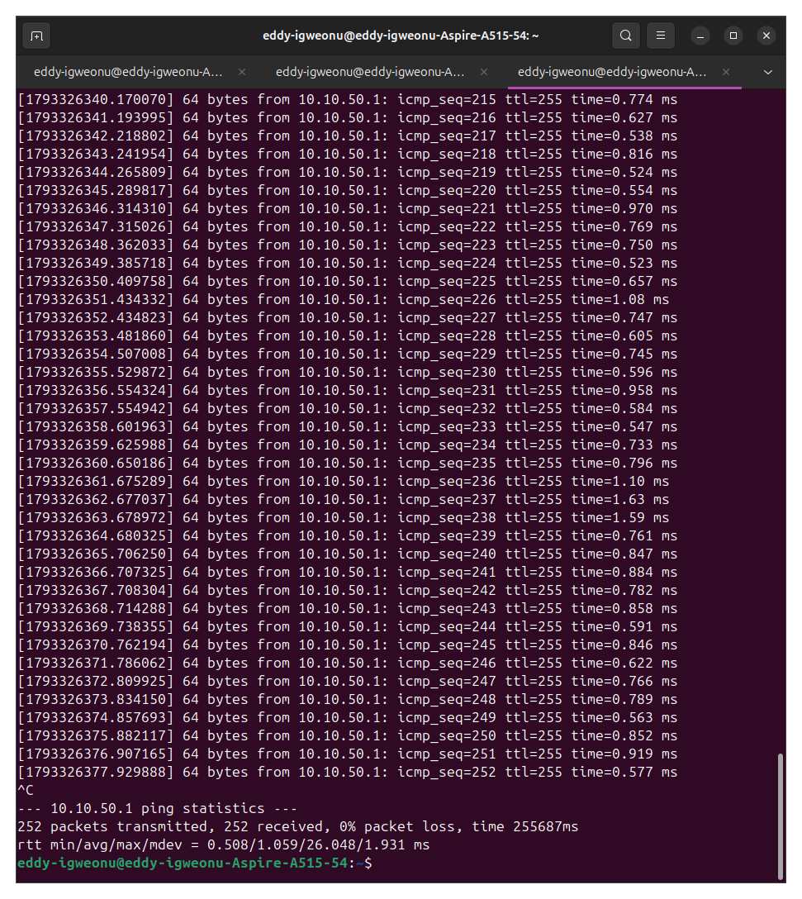
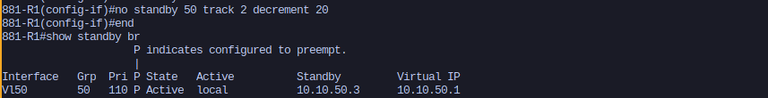
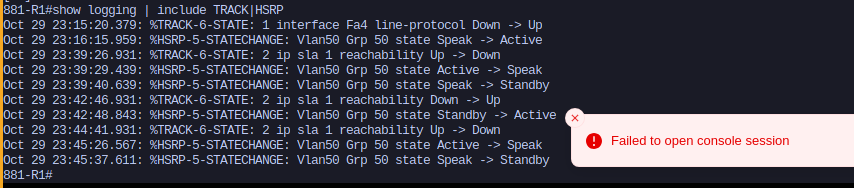

# 17 - IP SLA Reachability Tracking for HSRP

## Overview

This lab extends `16-hsrp-physical` to close a gap in how R1 decides it is healthy. In lab 16, R1 tracked the line protocol on its FE4 uplink, so it only stepped down as the HSRP Active router when the FE4 link itself went down. That catches a pulled cable, but it misses the more common real failure: the link stays up while the ISP router on the other end, or something beyond it, has stopped forwarding.

In that situation R1 keeps its priority, stays Active, and every host on the LAN keeps sending traffic to a router with no working way out. This lab adds IP SLA, so R1 actively tests whether its upstream path works and steps down when it doesn't, even with FE4 still up.

## Hardware

| Device | Details |
|---|---|
| 881-R1, 881-R2 | Cisco 881G (C881G+7-A-K9), IOS 15.7(3)M9, advipservices permanent license |
| Switch | Cisco Catalyst 2950 (c2950-i6q4l2-mz.121-22.EA2) |
| Acer | Ubuntu 24.04, acting as both the LAN client and the simulated ISP gateway |

## Topology

The physical wiring is the same as lab 16. The only change is that the Acer now also joins VLAN 60, as the "ISP" gateway both routers ping out FE4.

```
                        2950
        Fa0/3 (trunk)  Fa0/4 (trunk)  Fa0/17 (VLAN 60)  Fa0/18 (VLAN 60)  Fa0/1 (trunk)
            |               |                |                 |                |
          FE0             FE0              FE4               FE4       enp1s0.50 / enp1s0.60
         881-R1         881-R2           881-R1            881-R2            Acer
```

## Addressing

| Segment | VLAN | Subnet | 881-R1 | 881-R2 | Acer |
|---|---|---|---|---|---|
| Management | 1 | 10.10.30.0/24 | 10.10.30.21 | 10.10.30.22 | 10.10.30.250 |
| HSRP LAN | 50 | 10.10.50.0/24 | 10.10.50.2 | 10.10.50.3 | 10.10.50.10 (client) |
| Virtual IP | 50 | 10.10.50.1 | | | |
| WAN uplink | 60 | 10.10.60.0/24 | 10.10.60.2 | 10.10.60.3 | 10.10.60.1 (ISP gateway) |

## Configuration

### 2950

The Acer's trunk on Fa0/1 needed VLAN 60 added:

```
interface FastEthernet0/1
 switchport trunk allowed vlan add 60
```

### Acer as the ISP gateway

A second VLAN subinterface on the same cable, managed by NetworkManager so it survives link flaps:

```
sudo nmcli connection add type vlan con-name isp-gw dev enp1s0 id 60 ipv4.method manual ipv4.addresses 10.10.60.1/24
sudo nmcli connection up isp-gw
```

### 881-R1

Added on top of the lab 16 config:

```
ip sla 1
 icmp-echo 10.10.60.1 source-interface FastEthernet4
 frequency 5
 timeout 1000
!
ip sla schedule 1 life forever start-time now
!
track 2 ip sla 1 reachability
 delay down 10 up 15
!
interface Vlan50
 standby 50 track 2 decrement 20
```

R2's config is unchanged from lab 16.

## How it works

The setup has three layers, each feeding the next.

**IP SLA is the probe.** Every 5 seconds R1 sends a ping to 10.10.60.1 out FE4. A ping with no reply within 1 second counts as a failed probe. The SLA keeps probing on that schedule no matter what state anything else is in.

**The track turns results into a state.** Track 2 reads the SLA results and reports Up or Down, which is something HSRP can act on. The delay settings add patience: the track only goes Down after 10 seconds of continuous failure, so one lost ping doesn't cause a failover, and it only comes back Up after 15 seconds of continuous success, so a flapping path doesn't make HSRP bounce back and forth.

**HSRP acts on the track.** When track 2 goes Down, R1's priority drops from 110 to 90. R2 sits at 100 with preempt, so it takes over as Active. When track 2 recovers, R1 returns to 110 and preempts back.

Track 1 from lab 16 is still in place, so R1 now steps down for either reason: a dead link, or a link that is up with nothing answering beyond it. The decrements stack. If both tracks went down at once, R1 would sit at 70, still below R2. Each decrement is big enough on its own to put R1 under R2, which is the design rule that matters: a single failure has to be enough to trigger a failover.

## Simulating an upstream failure

To break R1's upstream without touching a cable, a firewall rule on the Acer silently drops pings coming from R1's FE4 address only:

```
sudo iptables -I INPUT -s 10.10.60.2 -p icmp -j DROP
```

R2's probes to the same gateway still get answered, which mirrors the real situation this design is for: R1's path is broken, R2's is fine, so R2 is a valid place to fail over to. Removing the rule restores R1's path:

```
sudo iptables -D INPUT -s 10.10.60.2 -p icmp -j DROP
```

## Verification

### Baseline

Before the test, the SLA was returning OK, track 2 was Up, and R1 was Active at 110.



### The link stays up

With the drop rule in place, FE4 on R1 still showed up/up. This is the failure lab 16's line-protocol tracking could not see.



### Track 2 goes down

After 10 seconds of failed probes, track 2 went Down.



### HSRP fails over

R1 dropped to priority 90 and moved to Standby, and R2 became Active.



### Client impact

The client on the Acer pinged the virtual gateway at 10.10.50.1 through the failure and the recovery. All 252 pings were answered with 0% loss. Normal replies came back in under about 1 ms, and the slowest single reply took 26 ms, which lines up with the moments the Active role moved between the routers.



### The comparison

To show the problem this lab solves is real, the SLA tracking was removed from R1 and the upstream was broken again. R1 stayed Active at priority 110 with no working path out, which is a black hole: the LAN keeps sending traffic to a router that can't forward it.



Tracking was then put back and the config saved.

### Logs

The router log shows the sequence of track and HSRP state changes through the test.



## Findings

**Interface tracking only knows the link is up.** It can't tell whether anything beyond the link is answering. Tracking reachability to the upstream gateway is what catches a failure where the link light stays green but the path is dead.

**Preempt on R2 is what makes tracking work.** When tracking lowers R1's priority, R1 is still alive and still sending hellos. Without preempt, R2 would never take the Active role from a working router, even one with a lower priority. Preempt isn't needed for a hard failure, where R1 stops sending hellos entirely and R2 takes over regardless. It is needed for any case where R1 is degraded but still running, which is exactly the case tracking exists for.

**The delay belongs to the track, not the SLA.** The SLA keeps probing every 5 seconds. The track is what waits for a sustained failure before reporting Down, and for a sustained recovery before reporting Up. Without that dampening, a single dropped probe could trigger a failover, and an unstable path could make the routers trade the Active role repeatedly.

## Known gaps

- Both routers probe the same gateway on the same segment. In a real deployment, R1 and R2 would usually have separate ISP links, and each would track its own upstream. Here the separate failure is simulated with a firewall rule on a shared gateway.
- The probe target is the next hop. Probing something further out (a public address or a host at another site) would also catch failures past the first ISP router, at the cost of depending on more of the path.
