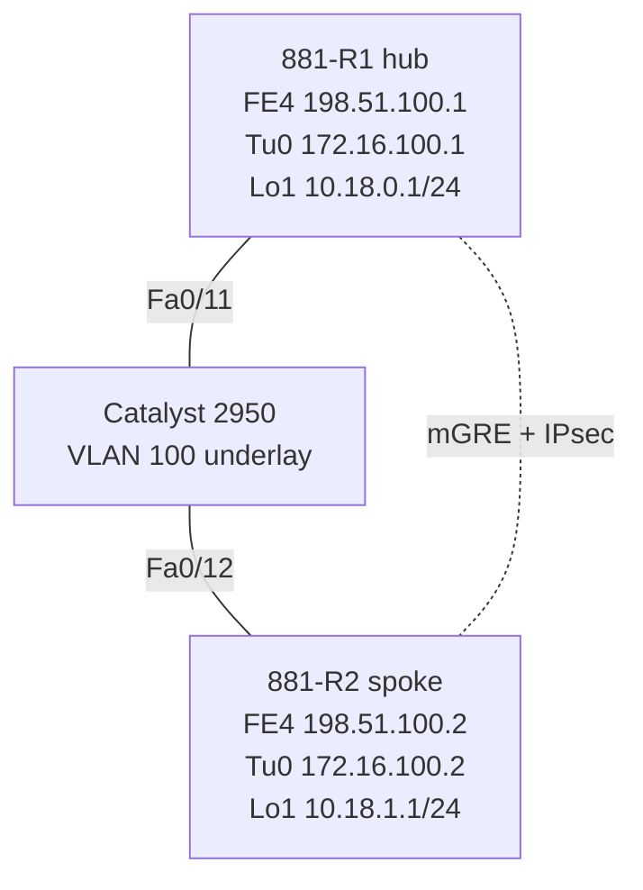
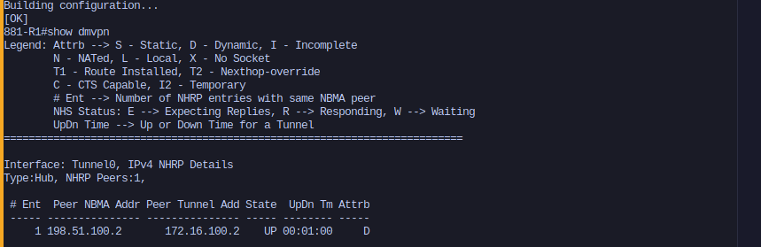
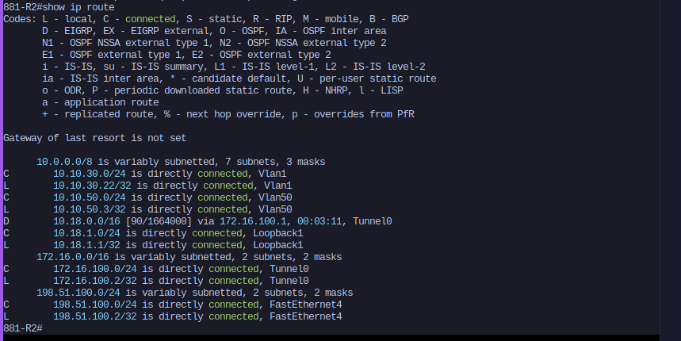
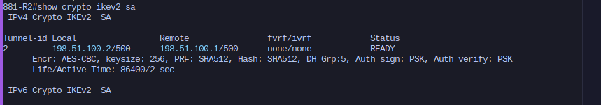
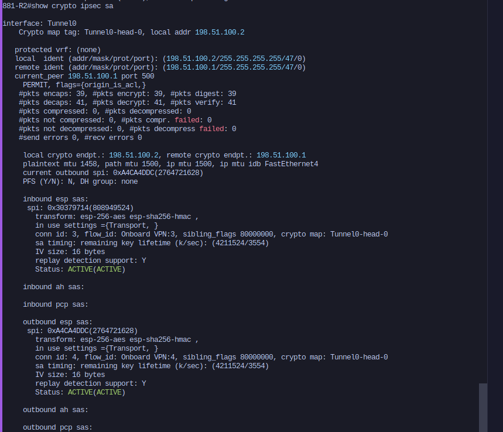
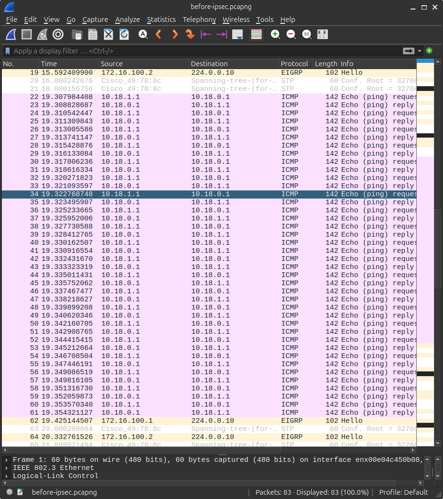
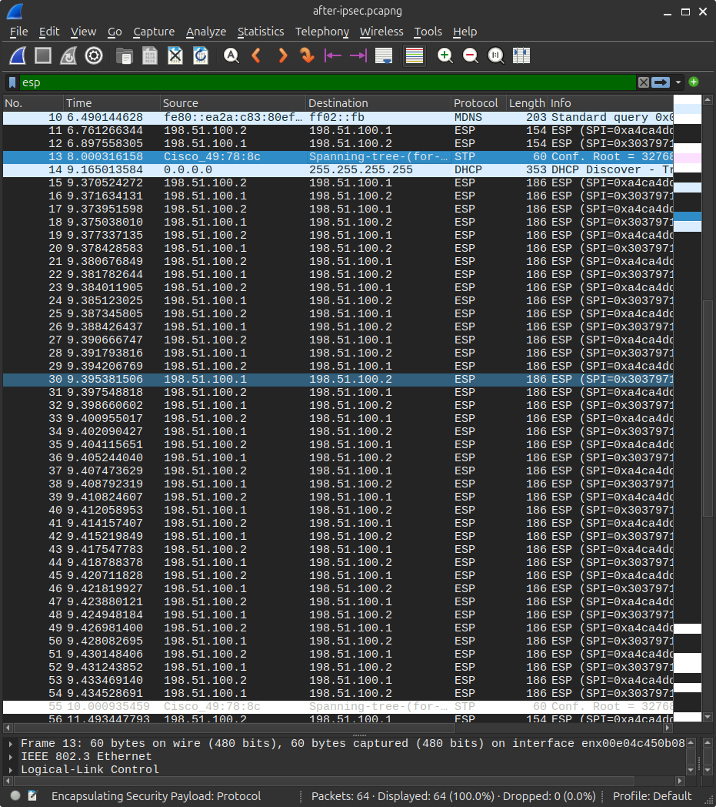

# 18-dmvpn-hub-spoke

DMVPN on two physical Cisco 881 routers, using a Catalyst 2950 as the "internet" underlay. The lab covers a working hub and spoke build: an mGRE tunnel, NHRP registration, EIGRP over the tunnel with a summary from the hub, and IKEv2/IPsec protecting the tunnel.

I set the routers up with the Phase 3 commands (`ip nhrp redirect` on the hub, `ip nhrp shortcut` on the spoke), but I didn't demonstrate Phase 3 itself. That needs a second spoke so you can watch the spoke-to-spoke shortcut form, and I only have two physical 881s. I planned to add a GNS3 c2691 as the second spoke and decided against it (more on that at the end), so treat the Phase 3 config here as configured but unverified.

## Hardware

- 2x Cisco 881 (C881G+7-A-K9, IOS 15.7(3)M9, advipservices)
- Cisco Catalyst 2950 (Layer 2 only, used as a flat underlay switch)
- Acer running Ubuntu 24.04 for SSH management and Wireshark captures

## Topology



| Device | Role | Underlay (FE4, VLAN 100) | Tunnel0 | LAN (Loopback1) |
|---|---|---|---|---|
| 881-R1 | Hub / NHS | 198.51.100.1/24 | 172.16.100.1/24 | 10.18.0.1/24 |
| 881-R2 | Spoke | 198.51.100.2/24 | 172.16.100.2/24 | 10.18.1.1/24 |

The 2950 can't route, so I put both routers' WAN ports in one VLAN (100) on Fa0/11 and Fa0/12. That gives each router a direct path to the other's public address, which is all DMVPN needs from the underlay. Management runs separately on VLAN 1 (10.10.30.0/24) through FE0 on each 881, so SSH and my Netmiko backups keep working no matter what the tunnel is doing.

The loopbacks stand in for branch LANs. I didn't want real hosts in the picture yet since the point of the lab is the overlay.

## Build order

I built it one layer at a time and checked each layer before moving on, so that if something broke I'd know where to look.

1. Underlay: VLAN 100 on the 2950, IPs on FE4, ping between the public addresses.
2. Overlay: mGRE and NHRP on Tunnel0, then confirm the spoke registered with the hub.
3. Routing: EIGRP 18 over the tunnel, with the hub advertising a 10.18.0.0/16 summary.
4. Encryption: IKEv2 and an IPsec profile on the tunnel.

## Configuration

### 2950

```
vlan 100
 name DMVPN-INTERNET
interface range fa0/11 - 12
 description DMVPN underlay
 switchport mode access
 switchport access vlan 100
 spanning-tree portfast
```

### 881-R1 (hub)

```
interface FastEthernet4
 description DMVPN underlay
 ip address 198.51.100.1 255.255.255.0
!
interface Loopback1
 description Hub LAN
 ip address 10.18.0.1 255.255.255.0
!
interface Tunnel0
 description DMVPN hub
 bandwidth 10000
 ip address 172.16.100.1 255.255.255.0
 no ip redirects
 ip mtu 1400
 ip tcp adjust-mss 1360
 ip nhrp authentication <placeholder>
 ip nhrp network-id 18
 ip nhrp map multicast dynamic
 ip nhrp redirect
 ip summary-address eigrp 18 10.18.0.0 255.255.0.0
 tunnel source FastEthernet4
 tunnel mode gre multipoint
 tunnel key 18
 tunnel protection ipsec profile DMVPN-IPSEC
!
router eigrp 18
 eigrp router-id 1.1.1.1
 network 172.16.100.0 0.0.0.255
 network 10.18.0.0 0.0.0.255
```

### 881-R2 (spoke)

```
interface FastEthernet4
 description DMVPN underlay
 ip address 198.51.100.2 255.255.255.0
!
interface Loopback1
 description Spoke1 LAN
 ip address 10.18.1.1 255.255.255.0
!
interface Tunnel0
 description DMVPN spoke 1
 bandwidth 10000
 ip address 172.16.100.2 255.255.255.0
 no ip redirects
 ip mtu 1400
 ip tcp adjust-mss 1360
 ip nhrp authentication <placeholder>
 ip nhrp network-id 18
 ip nhrp map 172.16.100.1 198.51.100.1
 ip nhrp map multicast 198.51.100.1
 ip nhrp nhs 172.16.100.1
 ip nhrp shortcut
 tunnel source FastEthernet4
 tunnel mode gre multipoint
 tunnel key 18
 tunnel protection ipsec profile DMVPN-IPSEC
!
router eigrp 18
 eigrp router-id 2.2.2.2
 network 172.16.100.0 0.0.0.255
 network 10.18.1.0 0.0.0.255
```

### IPsec (same on both routers)

```
crypto ikev2 keyring DMVPN-KEYS
 peer ANY
  address 0.0.0.0 0.0.0.0
  pre-shared-key <placeholder>
!
crypto ikev2 profile DMVPN-IKEV2
 match identity remote address 0.0.0.0
 authentication remote pre-share
 authentication local pre-share
 keyring local DMVPN-KEYS
!
crypto ipsec transform-set DMVPN-TS esp-aes 256 esp-sha256-hmac
 mode transport
!
crypto ipsec profile DMVPN-IPSEC
 set transform-set DMVPN-TS
 set ikev2-profile DMVPN-IKEV2
```

The keyring accepts any peer address on purpose. In a real DMVPN, spokes can show up from addresses the hub has never seen, so you can't list them ahead of time. Transport mode is enough because GRE already provides the outer IP header.

## Verification

### The spoke registered with the hub

```
881-R1#show dmvpn
Interface: Tunnel0, IPv4 NHRP Details
Type:Hub, NHRP Peers:1,

 # Ent  Peer NBMA Addr Peer Tunnel Add State  UpDn Tm Attrb
 ----- --------------- --------------- ----- -------- -----
     1 198.51.100.2       172.16.100.2    UP 00:01:00     D
```

The `D` means the hub learned this spoke dynamically through NHRP. Nothing in the hub's config mentions the spoke, which is the main selling point of DMVPN. Adding a branch only means touching the branch router.



### The spoke only sees the summary

```
881-R2#show ip route
D        10.18.0.0/16 [90/1664000] via 172.16.100.1, 00:03:11, Tunnel0
C        10.18.1.0/24 is directly connected, Loopback1
C        172.16.100.0/24 is directly connected, Tunnel0
C        198.51.100.0/24 is directly connected, FastEthernet4
```

The spoke has no specific route to the hub LAN, just the /16 summary pointing at the hub. With more spokes, this is what keeps branch routing tables small. It's also the setup Phase 3 relies on: the spokes only know the summary, and NHRP redirects build the direct paths when traffic needs them.



### IKEv2 and IPsec are up

```
881-R2#show crypto ikev2 sa
Tunnel-id Local                 Remote                fvrf/ivrf            Status
2         198.51.100.2/500      198.51.100.1/500      none/none            READY
      Encr: AES-CBC, keysize: 256, PRF: SHA512, Hash: SHA512, DH Grp:5, Auth sign: PSK, Auth verify: PSK
```

An SA existing doesn't prove traffic is actually getting encrypted, so I also checked the IPsec counters before and after a 20-packet ping from the spoke LAN to the hub LAN:

| | Before ping | After ping |
|---|---|---|
| `#pkts encaps` | 17 | 39 |
| `#pkts decaps` | 18 | 41 |

The counters went up by 22 and 23. That's the 20 pings plus a few EIGRP hellos that went through during the test, with no send or receive errors.




### Wire capture, before and after IPsec

I mirrored the spoke's underlay port (Fa0/12) to a USB adapter on the Acer (Fa0/10) using SPAN, and captured in Wireshark. Before IPsec, you can see GRE packets with the ICMP and EIGRP inside them in plain text. After IPsec, the same traffic only shows up as ESP.




## Findings

**IKEv2 smart defaults picked a weak DH group.** I never configured an IKEv2 proposal or policy, so IOS used its built-in defaults. AES-256 with SHA512 looks fine, but it negotiated DH group 5 (1536-bit MODP), which is deprecated. It works, but in production I'd define an explicit proposal with group 14 or higher and not leave it to the defaults.

**The default tunnel bandwidth is tiny.** Tunnel interfaces default to 100 kbps. EIGRP uses that figure for its metric and to cap how much bandwidth its own packets use, so I set `bandwidth 10000` on both ends.

**Keep EIGRP network statements tight.** The wildcard masks only match the tunnel subnet and the loopback. If the 198.51.100.0/24 underlay ever got advertised through the tunnel, the router would try to reach the tunnel destination through the tunnel itself. That's recursive routing, and the tunnel just flaps.

**The summary adds a Null0 route on the hub.** `ip summary-address` installs 10.18.0.0/16 to Null0 on the hub. That's normal. It's a discard route that stops the hub from bouncing traffic for unused parts of the summary back toward a spoke.

**MTU headroom.** `show crypto ipsec sa` shows a plaintext MTU of 1458 on the 1500-byte FE4 link, which is what's left once ESP and GRE take their share. Setting the tunnel's `ip mtu` to 1400 and `adjust-mss` to 1360 keeps everything comfortably under that, so nothing fragments.

**Don't mirror to your management port.** On the 2950, a SPAN destination port stops passing normal traffic. If I'd mirrored to Fa0/1, where the Acer's management link is, I'd have lost my SSH sessions, so the capture went to the USB adapter on its own port.

## What I didn't do, and why

The original plan was a second phase with a GNS3 c2691 as spoke 2 on Fa0/13, connected to the 2950 through a GNS3 Cloud node. The demo would have been a traceroute between the two spoke loopbacks: the first packets go through the hub, then NHRP builds a direct spoke-to-spoke tunnel, which you'd confirm with `show ip nhrp shortcut` and `show dmvpn` on each spoke.

I stopped before building it for two reasons:

- My c2691 image is IOS 12.4(15)T, and IKEv2 didn't show up until 15.1. Adding it as a spoke would have meant moving all three routers from IKEv2 to IKEv1, since the hub applies one IPsec profile to the whole tunnel.
- The Cloud node to physical NIC path in GNS3 is the same one that stopped forwarding frames in my VRRP lab (10-vrrp-fhrp), and I never fully figured out why.

Between those two, it was a lot of work and risk for one extra demo, so I'm leaving the lab as a hub and spoke build. If I come back to it, the cleaner route would be a third physical router running IOS 15.x, so all three could stay on IKEv2. I'd also fix the DH group while I'm at it.

Small cleanup still to do: both 881s have a leftover Vlan50 interface from the HSRP lab (16-hsrp-physical).
