# 19 - Zone-Based Firewall on Cisco 881

A zone-based policy firewall (ZBF) built on a physical Cisco 881 router, with three security zones (INSIDE, DMZ, OUTSIDE) and real hosts in each one. A second 881 plays the role of the internet. The goal was to show stateful inspection, default-deny between zones, and per-zone-pair policy on real Cisco hardware, as the IOS counterpart to the Linux iptables firewall in lab 02.

## Topology

```
                         2950 (mgmt only, VLAN 1)
                 Fa0/1         Fa0/23         Fa0/24
                   |             |              |
             Acer enp1s0     881-R1 FE0     881-R2 FE0
            10.10.30.250    10.10.30.21    10.10.30.22


   Mac ------- FE1 [ 881-R1 ] FE4 ------------- FE4 [ 881-R2 ]
   INSIDE        |  firewall                         "internet"
   10.10.110.10  |
                FE2
                 |
            Acer USB adapter
            DMZ 10.10.120.10
            (python3 http.server on port 80)
```

| Zone | R1 interface | Subnet | Host |
|---|---|---|---|
| INSIDE | Vlan110 (FE1 access) | 10.10.110.0/24 | MacBook at .10 |
| DMZ | Vlan120 (FE2 access) | 10.10.120.0/24 | Acer USB adapter at .10, running a web server |
| OUTSIDE | FastEthernet4 (routed) | 203.0.113.0/24 | 881-R2 at .2, HTTP and SSH enabled |
| none | Vlan1 (FE0 access) | 10.10.30.0/24 | Management SSH from the Acer |

Six cables total. The R1 to R2 outside link is a direct cable between the two FE4 ports, the way a firewall WAN port would normally connect to an ISP handoff. The 2950 only carries management traffic in this lab.

R2 has static routes back to 10.10.110.0/24 and 10.10.120.0/24 via 203.0.113.1. There is no NAT, so the policy is easier to read in the logs.

## Security policy

| Source | Destination | Allowed |
|---|---|---|
| INSIDE | OUTSIDE | TCP, UDP, ICMP (inspected) |
| INSIDE | DMZ | HTTP to 10.10.120.10, ICMP |
| OUTSIDE | DMZ | HTTP to 10.10.120.10 only |
| OUTSIDE | INSIDE | Nothing (no zone pair) |
| DMZ | INSIDE | Nothing (no zone pair) |

Return traffic is never explicitly allowed. It gets back in because `inspect` builds a session for the outbound connection, which is the whole point of a stateful firewall.

## Configuration

Full configs for both routers are in [`configs/`](configs/), with secrets redacted. The core of the R1 policy:

```
zone security INSIDE
zone security DMZ
zone security OUTSIDE

ip access-list extended DMZ-WEB-SERVER
 permit tcp any host 10.10.120.10 eq www

class-map type inspect match-any INSIDE-OUT-PROTOS
 match protocol tcp
 match protocol udp
 match protocol icmp
class-map type inspect match-any ICMP
 match protocol icmp
class-map type inspect match-all TO-DMZ-WEB
 match protocol http
 match access-group name DMZ-WEB-SERVER

policy-map type inspect IN-TO-OUT
 class type inspect INSIDE-OUT-PROTOS
  inspect
 class class-default
  drop log
policy-map type inspect IN-TO-DMZ
 class type inspect TO-DMZ-WEB
  inspect
 class type inspect ICMP
  inspect
 class class-default
  drop log
policy-map type inspect OUT-TO-DMZ
 class type inspect TO-DMZ-WEB
  inspect
 class class-default
  drop log

zone-pair security IN-OUT source INSIDE destination OUTSIDE
 service-policy type inspect IN-TO-OUT
zone-pair security IN-DMZ source INSIDE destination DMZ
 service-policy type inspect IN-TO-DMZ
zone-pair security OUT-DMZ source OUTSIDE destination DMZ
 service-policy type inspect OUT-TO-DMZ

interface Vlan110
 zone-member security INSIDE
interface Vlan120
 zone-member security DMZ
interface FastEthernet4
 zone-member security OUTSIDE
```

Interfaces were assigned to zones last, since traffic starts dropping the moment an interface joins a zone.

## Baseline (before ZBF)

Before any zones were applied, every host could reach every other host. This confirms routing and cabling are good, so any failure later is the firewall and nothing else.

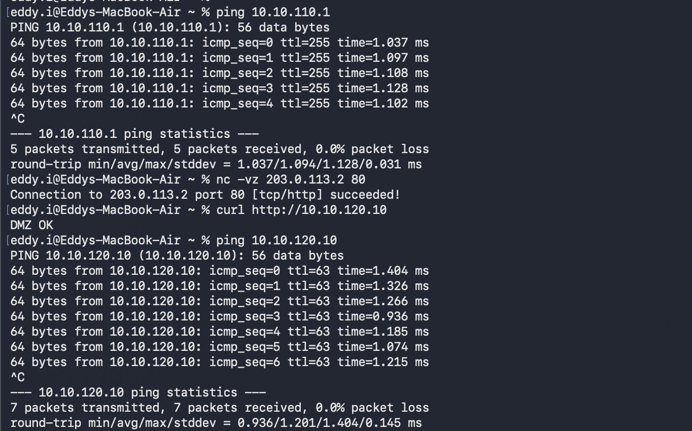

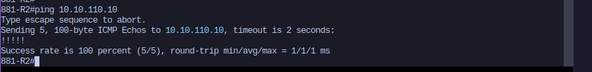

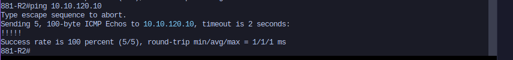

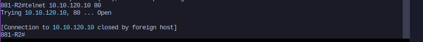

## Zones and zone pairs

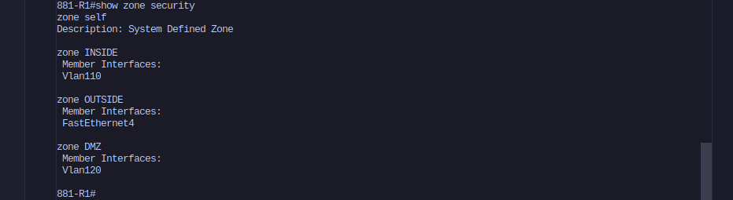

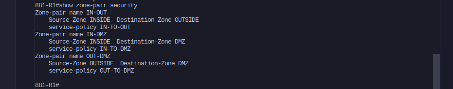

## Troubleshooting: the match-all class-map

After applying the zones, every test from the Mac failed, including plain inside to outside traffic that should have been allowed. The drop log showed exactly where:

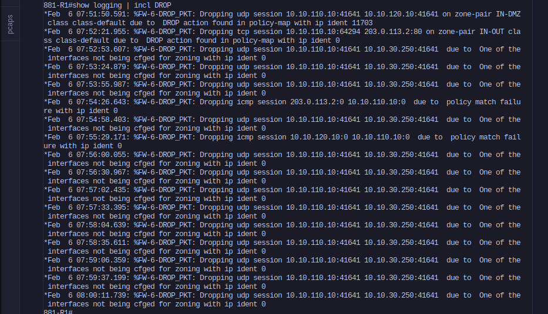

The traffic was hitting the right zone pair (IN-OUT) but falling through to class-default instead of matching INSIDE-OUT-PROTOS. The class-map had been created as `match-all`, which is the default when the keyword is left out. Match-all means a packet has to be TCP and UDP and ICMP at the same time, so nothing ever matched.

The fix was to detach the class from the policy-map, delete it, recreate it as `match-any`, and attach it again. IOS won't let you delete a class-map that a policy-map is still using.

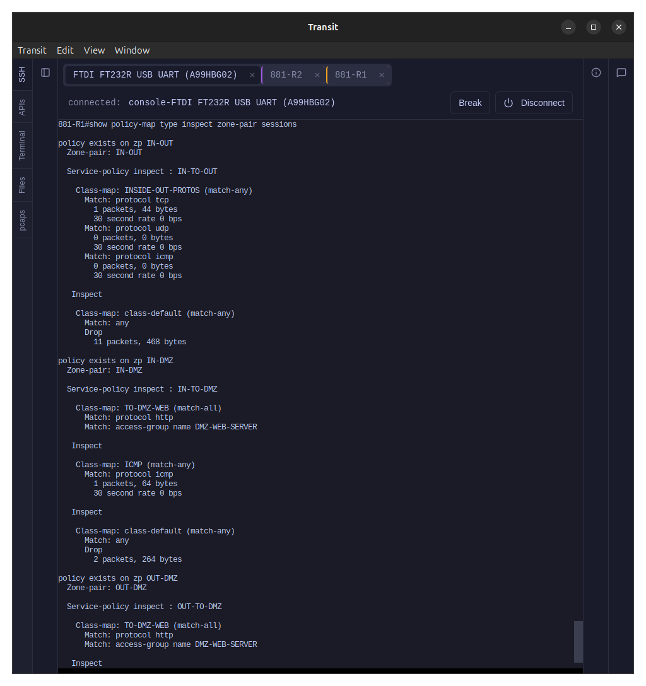

## Results after ZBF

| From | Test | Result | What it proves |
|---|---|---|---|
| Mac | `ping 203.0.113.2` | Pass | Inside can reach outside |
| Mac | `nc -vz 203.0.113.2 80` | Pass | Stateful return traffic is allowed |
| Mac | `curl http://10.10.120.10` | Pass | Inside can reach the DMZ web server |
| Mac | `ping 10.10.120.10` | Pass | Inside can ping the DMZ |
| R2 | `telnet 10.10.120.10 80` | Open | Outside can reach DMZ web only |
| R2 | `ping 10.10.120.10` | Blocked | Outside can't ping the DMZ |
| R2 | `ping 10.10.110.10` | Blocked | Outside can't reach inside |
| Acer | `ping -I <adapter> 10.10.110.10` | Blocked | DMZ can't reach inside |

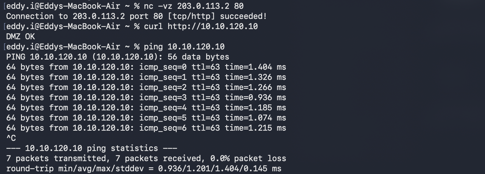

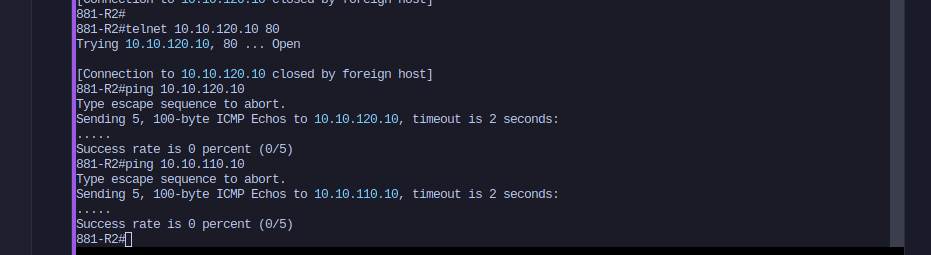

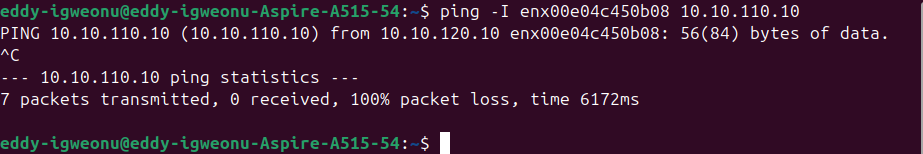

## Stateful sessions

To catch sessions in the table, I held a connection open in each zone pair: a continuous ping from the Mac to R2 (IN-OUT), an idle `nc` from the Mac to the DMZ web server (IN-DMZ), and an idle `telnet` from R2 to the DMZ web server (OUT-DMZ). A normal curl finishes too fast to show up.

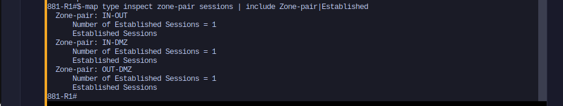

## Drop counters

To show the policy actually dropping traffic, I took the class-default counters before and after sending blocked traffic: 20 pings from R2 to the DMZ host (hits OUT-DMZ, which only allows HTTP), and a few SSH attempts from the Mac to the DMZ host (hits IN-DMZ, which only allows HTTP and ICMP).

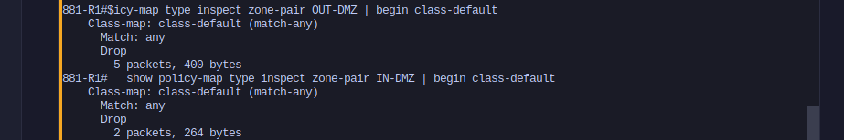

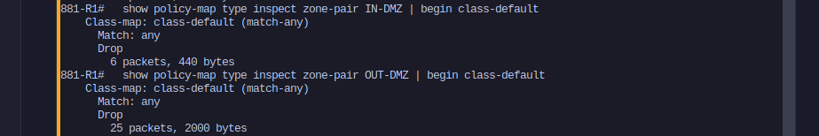

The blocked tests that have no zone pair at all (outside to inside, DMZ to inside) don't show up in any counter, because there is no policy for them to count against. Those drops only show up in the log.

## Findings

**No zone pair means drop, with no counters.** ZBF is default-deny between zones. OUTSIDE to INSIDE and DMZ to INSIDE were never configured, so that traffic was dropped and only visible as `policy match failure` log lines.

**Zoned to unzoned traffic is always dropped.** Vlan1 (management) was deliberately left out of every zone so SSH to the router would keep working. That works because traffic to the router itself goes to the self zone, which allows everything by default unless a self zone pair is configured. But traffic passing through the router between a zoned and an unzoned interface is dropped. This showed up when Tailscale on the Mac tried to reach the Acer's management address:

```
%FW-6-DROP_PKT: Dropping udp session 10.10.110.10:41641 10.10.30.250:41641  due to  One of the interfaces not being cfged for zoning
```

**Background traffic pollutes the log.** UDP 41641 is Tailscale looking for direct paths to other devices. It was dropped constantly on IN-DMZ and toward Vlan1, which buried the drops I was actually testing for. Quitting Tailscale on the Mac during testing cleaned it up.

**Drop logs are rate limited.** The `%FW-6-DROP_PKT` lines came in roughly 30 seconds apart no matter how much traffic was being dropped. The log is good for seeing which zone pair and class dropped something, but the counters in `show policy-map type inspect zone-pair` are the place to count drops.

**Cleaning up old labs can cut off management.** Before building this lab I removed the leftover DMVPN, HSRP and IP SLA config from both 881s. Removing VLAN 50 dropped my SSH session, because management had moved onto a Vlan50 SVI during an earlier lab. I recovered over the console and moved management back onto Vlan1 at 10.10.30.21 and .22. Lesson: check which interface carries your management IP before deleting anything, and keep a console cable nearby.

**Host routing matters.** With Wi-Fi on, the Mac sent 203.0.113.x traffic out Wi-Fi instead of the lab cable, because its Wi-Fi default route took priority. Turning Wi-Fi off for the lab fixed it. On the Acer, the DMZ routes had to be added after the adapter had its IP, since Linux rejects a gateway that isn't on a connected subnet (`Nexthop has invalid gateway`).

## Files

```
19-zbf-881/
├── README.md
├── configs/
│   ├── 881-R1-zbf.cfg
│   └── 881-R2-zbf.cfg
└── screenshots/
    ├── 01-baseline-mac.png
    ├── 02-baseline-r2-ping-inside.png
    ├── 02-baseline-r2-ping-dmz.png
    ├── 02-baseline-r2-telnet-dmz.png
    ├── 03-zone-security.png
    ├── 04-zone-pair-security.png
    ├── 05-match-all-bug-log.png
    ├── 06-class-map-fixed.png
    ├── 07-after-zbf-mac.png
    ├── 08-after-zbf-r2.png
    ├── 09-after-zbf-dmz-to-inside.png
    ├── 10-live-sessions.png
    ├── 11-counters-before.png
    └── 12-counters-after.png
```
