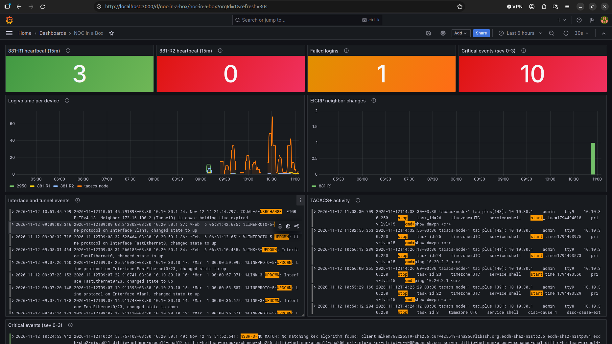
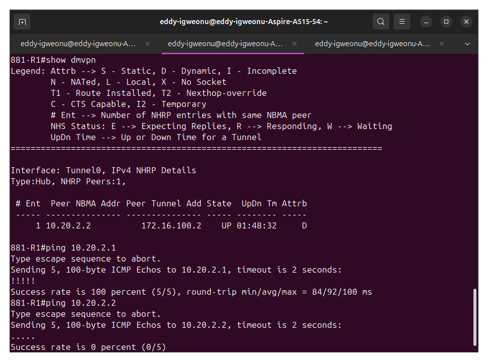
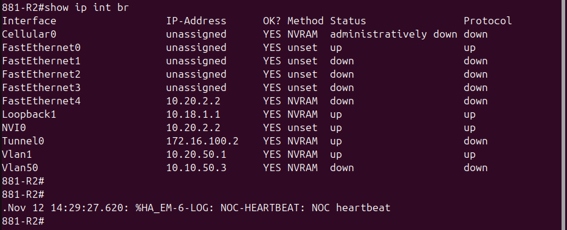
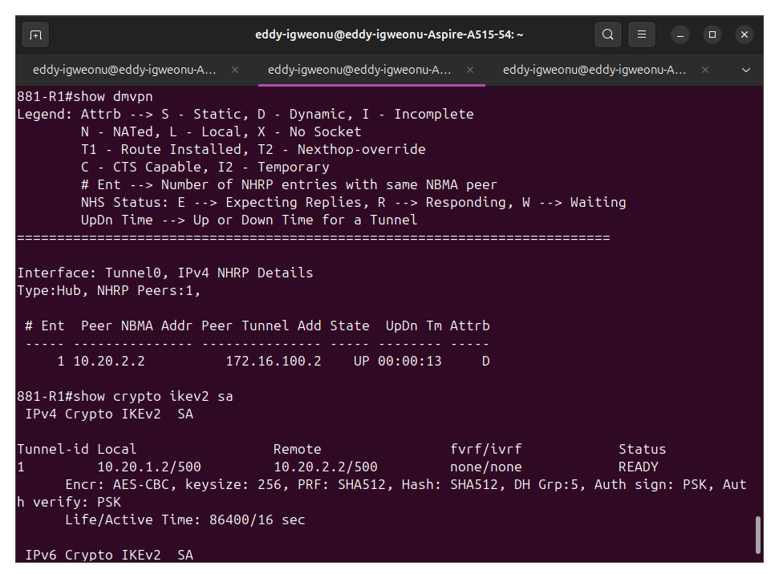
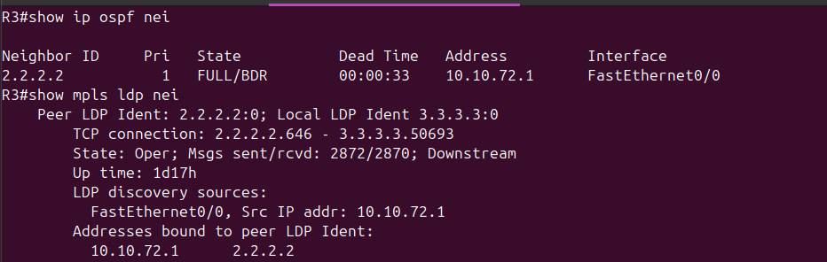
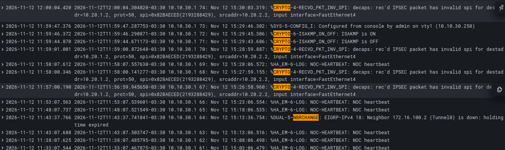

# Lab 20 incident tickets

All times are UTC, to match the device logs. The backup folder names in these tickets are in the Acer's local time (NST, UTC-3:30), because that's how backup.py named them at the time. It names them in UTC now. Grafana screenshots also show NST, since that's what my browser uses.

## Found during the build (INC-01 to INC-04)

These four weren't staged. They came up for real while I was building the lab
and I fixed them as I went, so there are no timelines, just what happened.

**INC-01 EIGRP hellos on the wrong LAN.** EIGRP "not on common subnet" messages
in the logs. 881-R2 FE0 was still cabled to the 2950 from an earlier lab, so
both 881s were sending hellos onto the same LAN. Moved 881-R2 FE0 to the SG105E
and made the LAN SVIs passive-interface so hellos only go over the tunnel.

**INC-02 Duplex mismatch on the PE-CE links.** CDP duplex mismatch warnings
between the 881 FE4s and the c2691 PEs. The c2691 interfaces default to half
duplex. Set speed 100 and duplex full on R2 Fa0/0 and R4 Fa0/1.

**INC-03 Local login rejected while TACACS+ was up.** Tried logging in with the
local account and got rejected. The local fallback only kicks in when the
TACACS+ server can't be reached. If the server is up and says no, that's the
final answer.

**INC-04 TACACS+ server down.** With tacacs-node down, accounting stopped and
it showed up as a gap in the TACACS+ panel in Grafana. When I restarted it,
the accounting lines came back, so the dashboard showed both the outage and the
recovery.

## INC-05 Branch site unreachable

Trigger: pulled the cable on the branch WAN link (USB adapter 2 to 881-R2 F4) at 14:20:00.

Timeline
- 14:20:00  cable pulled
- 14:21:45  saw it on the Grafana dashboard, EIGRP neighbor down to 172.16.100.2
- pinged 10.20.50.1 from the Acer, no reply. Whole branch is down
- 14:25  881-R1: show dmvpn still has the spoke UP, 5 min after the pull. No
  DPD yet so nothing told the hub it was gone. Ping to the branch PE
  (10.20.2.1) works, ping to the branch WAN (10.20.2.2) fails. So the carrier
  gets as far as the branch PE and the problem is past it, the branch link or
  the router. (In GNS3, R4's Fa0/1 doesn't notice a cable pulled on the far
  side of the Cloud node. On a real PE that interface would go down too.)
- 14:33  show dmvpn again, spoke finally gone
- consoled into 881-R2 from the Mac. show ip int br, F4 down/down. Physical
  problem at the branch
- plugged the cable back in. F4 came up but the tunnel didn't
- R4 couldn't ping 10.20.2.2 either. ip link on the Acer showed the adapter as
  interface 34, it was 15 before. The USB NIC reset when it lost link and the
  GNS3 Cloud node was still stuck on the old one
- deleted the Cloud node, added a new one on enx9c69d392e20c, relinked to R4
- 15:00:30  spoke UP in show dmvpn, IKEv2 SA READY, heartbeat green again

Impact: branch had no access to HQ services and I couldn't manage 881-R2 except
by console.

Time to detect: 1 min 45 sec. Total outage: about 40 min, most of it the
recovery problem, not the original fault.

Root cause: F4 link down. The slow recovery was the USB adapter re-enumerating
and leaving a stale binding in GNS3.

Lessons
- link back up doesn't mean service is back, check the tunnel and the dashboard
  before calling it fixed
- USB NICs aren't great for anything that needs to stay up

Follow-up: noticed the IKEv2 SA is using DH group 5, which is weak. Should move
to group 14 or higher.

Screenshots









## INC-06 Carrier core failure

Trigger: shut R3 Fa0/1 (carrier core link to R4). Didn't note the exact time.

Timeline
- 15:13:37  Grafana, EIGRP neighbor 172.16.100.2 down on Tunnel0 (holding time
  expired). No interface down message this time, unlike INC-05
- 881-R1: show dmvpn, spoke gone. Ping to my own PE (10.20.1.1) works, ping to
  the branch WAN (10.20.2.2) fails. So HQ is fine, problem is at the branch or
  in the carrier
- consoled into 881-R2. F4 up/up, and ping to its own PE (10.20.2.1) works
- both sites can reach their own PE but not each other, so the problem is
  inside the carrier. In real life this is where I'd open a ticket with the
  provider and send both ping results
- as the carrier: R3 show ip ospf neighbor and show mpls ldp neighbor both
  missing R4. show ip int br had Fa0/1 admin down. no shut on Fa0/1
- OSPF and LDP came back on R3, BGP 4.4.4.4 back up on R2, but the tunnel
  stayed down
- 881-R1 logs showed %CRYPTO-4-RECVD_PKT_INV_SPI from 10.20.2.2 every minute.
  The branch was still using its old IPsec session and the hub had already
  dropped it, so every packet was thrown away
- clear crypto session on 881-R2
- 15:35:41  spoke UP in show dmvpn, heartbeat green again

Impact: branch lost access to HQ services and 881-R2 was out of management
except by console.

Time to detect: not measured, since I didn't note when I shut the link. The
EIGRP hold time on Tunnel0 is 15 sec, so the neighbor drop at 15:13:37 was at
most about 15 sec after the fault. Total outage: about 22 min from detection,
most of it the VPN not recovering after the carrier was fixed.

Root cause: carrier core link R3 Fa0/1 down. The slow recovery was a stale
IPsec session on the branch, since DPD wasn't configured.

Prevention: added IKEv2 DPD (dpd 10 3 on-demand) so a dead session gets torn
down and renegotiated on its own.

Lessons
- one ping tells you whose network it is. In INC-05 the branch couldn't reach
  its PE, here it could
- carrier fixed doesn't mean my service is fixed

Screenshots





## INC-07 Branch VPN down after PSK change

Trigger: changed the IKEv2 pre-shared key on 881-R2 as admin at 11:57, then
forced the rekey with clear crypto session at 12:04:14. In real life the change
and the outage could be hours apart, the clear just stands in for the next rekey.

Timeline
- 11:51  baseline backup, 6 of 6 (folder 2026-11-14_0821)
- 11:57  admin changes the PSK on 881-R2. Tunnel stays up, the old SA is still
  good
- 11:58  backup runs again, 6 of 6, picks up the new key (folder 2026-11-14_0828)
- 12:04:14  clear crypto session on 881-R2, tunnel drops
- 12:04:40  Grafana, EIGRP neighbor 172.16.100.2 down. Branch unreachable
- 881-R1: no EIGRP neighbors, ping to own PE works, ping to 10.20.50.1 fails.
  No IKEv2 SA for 10.20.2.2, so it's something in IKEv2 or IPsec
- ping 10.20.2.2 source Fa4 works, so the carrier is fine. Not a repeat of
  INC-06
- 12:15:05  debug crypto ikev2 on 881-R1, spoke keeps retrying and auth keeps
  failing. Keys don't match
- TACACS+ accounting in Grafana shows admin changing the pre-shared-key on
  881-R2 at 11:57. diff between the 0821 and 0828 backups shows the same line
  changed
- python backup.py only gets 5 of 6, 881-R2 fails because SSH to it goes
  through the tunnel
- consoled into 881-R2, logged in as local user eddy since TACACS+ was
  unreachable from the branch. Put the PSK back from the 0821 backup, then wr
- 12:23:48  EIGRP neighbor back, show crypto ikev2 sa READY, show dmvpn shows
  10.20.2.2 up, ping to 10.20.50.1 works
- 12:29  backup 6 of 6, diff between 0821 and 0859 is clean, heartbeat green

Impact: branch lost access to HQ services. 881-R2 couldn't reach TACACS+ so it
fell back to local accounts, NTP to 10.10.30.1 was lost, and no branch logs
reached HQ until the tunnel came back. SSH to the branch failed, which is why
the backup only got 5 of 6.

Time to detect: 26 sec. Time to resolve from detection: 19 min 08 sec. Total
outage: 19 min 34 sec.

Root cause: PSK on 881-R2 changed by admin at 11:57, no longer matched the hub.
Nothing broke until the tunnel rekeyed at 12:04:14.

Prevention
- any crypto change gets tested with a forced clear crypto session during the
  change window, not left for the next rekey
- schedule backup.py with cron and alert when the diff isn't empty
- out of band access for the branch, since in-band management rides the tunnel

Follow-up: check whether TACACS+ accounting logged the new key in cleartext.

Lessons
- the change and the outage were 7 min apart here and could be hours apart in
  production, so "what changed recently" has to look back further than the
  outage
- the backup and the management path both ride the thing that broke

## INC-08 Branch logs go silent

Trigger: applied an inbound ACL on 881-R1 Tunnel0 as admin. Accounting puts it
at 13:08:31. I ran date -u at 13:07:05 before typing it, so the accounting time
is the real one.

The ACL:

```
ip access-list extended BRANCH-FILTER
 deny udp host 10.20.50.1 host 10.10.30.250 eq 514
 permit ip any any
interface Tunnel0
 ip access-group BRANCH-FILTER in
```

Timeline
- 13:05  baseline backup, 6 of 6 (folder 2026-11-14_0935)
- 13:07:42  last log from 881-R2 reaches the Acer, the NOC heartbeat
- 13:08:31  BRANCH-FILTER applied inbound on 881-R1 Tunnel0
- about 13:23  881-R2 heartbeat tile red in Grafana. EIGRP and tunnel panels
  quiet, so the network looks fine
- SSH into 881-R1 works, ping 10.20.50.1 works from HQ and from the Acer.
  Branch is up
- show logging on 881-R2, still logging to 10.10.30.250 and the count goes up.
  Branch is sending, so it's not the problem
- tcpdump on enp1s0 for udp 514 from 10.20.50.1, nothing shows up after send
  log on 881-R2. Logs leave the branch and never reach the Acer, so something
  in the path, and the only thing in the path is 881-R1
- show ip int tun0 on 881-R1, inbound ACL BRANCH-FILTER. Deny counter goes up
  every time I run send log
- accounting in Grafana shows admin applied it at 13:08:31
- removed the access-group from Tunnel0, then the ACL, wr
- 13:32  send log shows up in tcpdump and Grafana, heartbeat tile green

Impact: branch lost syslog visibility for about 24 min. No users affected, SSH
and TACACS+ still worked. Syslog is UDP so the dropped logs never get resent,
they only exist in 881-R2's local buffer.

Time to detect: about 14 min, because of the 15 min tile window. Total outage:
about 24 min.

Root cause: inbound ACL BRANCH-FILTER on 881-R1 Tunnel0 denying UDP 514 from
10.20.50.1 to 10.10.30.250, applied by admin at 13:08:31. Accounting line:

```
2026-11-14T13:08:31-03:30 tacacs-node-1 tac_plus[322]: 10.10.30.1 admin tty8 10.10.30.250 stop task_id=33 timezone=UTC service=shell start_time=1794661711 priv-lvl=15 cmd=ip access-group BRANCH-FILTER in <cr>
```

Prevention
- shorter heartbeat window, or a Grafana alert on log silence per host instead
  of waiting for someone to notice a red tile
- peer review for ACLs on the tunnel

Follow-up: the accounting line above says 13:08:31-03:30 but the time is
really UTC. The tacacs-node container stamps its own UTC time with no zone and
the Acer's rsyslog assumes it's local. Anyone lining up TACACS+ lines against
other logs by raw timestamp would be off by 3h30.

Lessons
- detection by absence is only as fast as the window. INC-07 got caught in 26
  sec, this one took about 14 min, and everything else looked healthy the whole
  time
