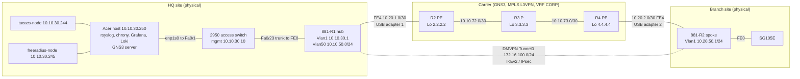
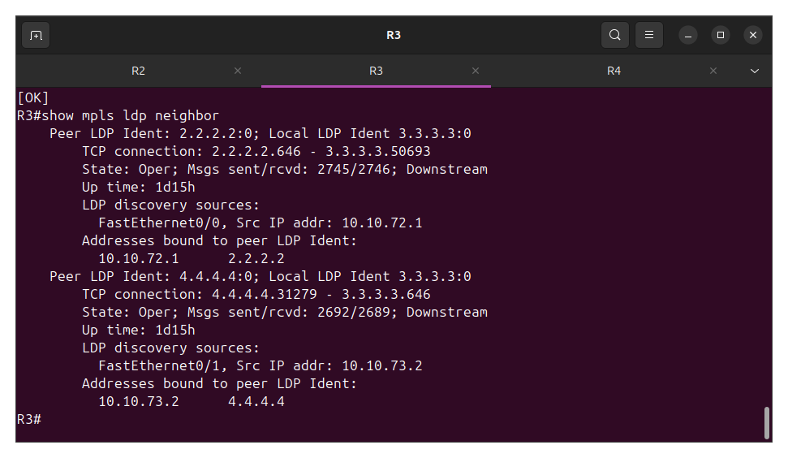
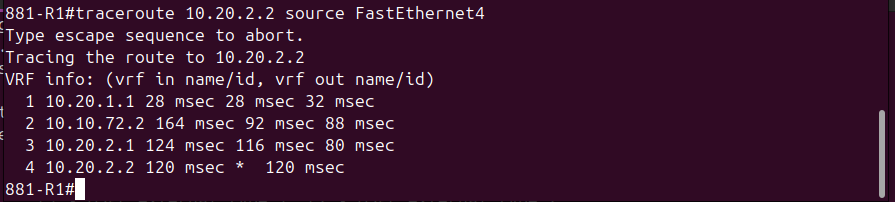
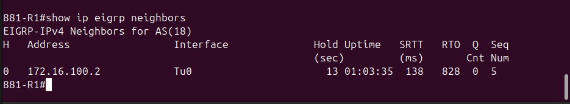
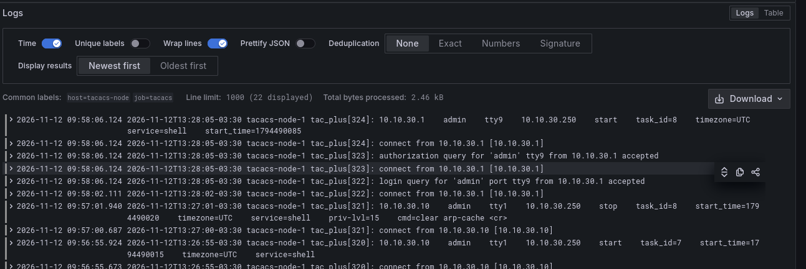
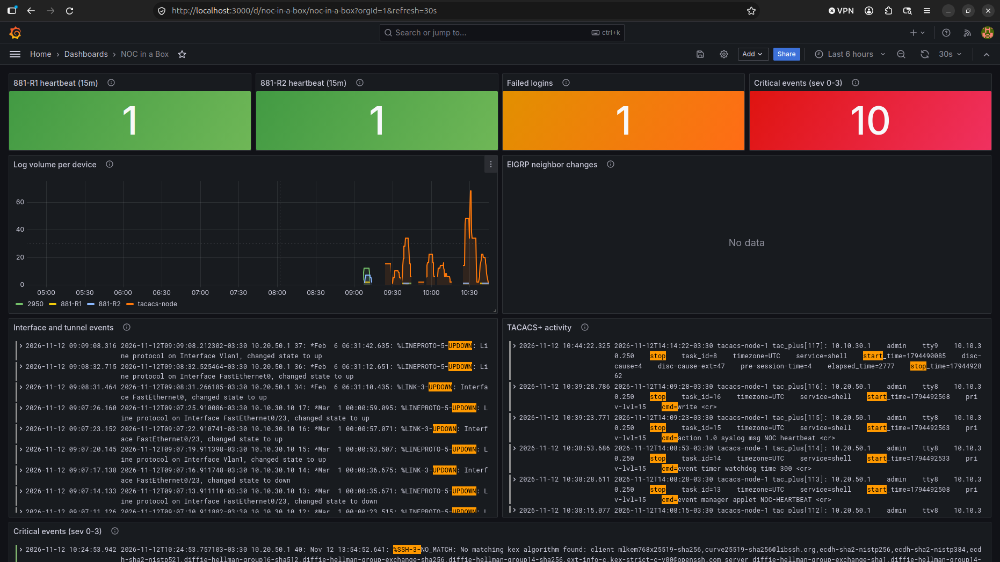
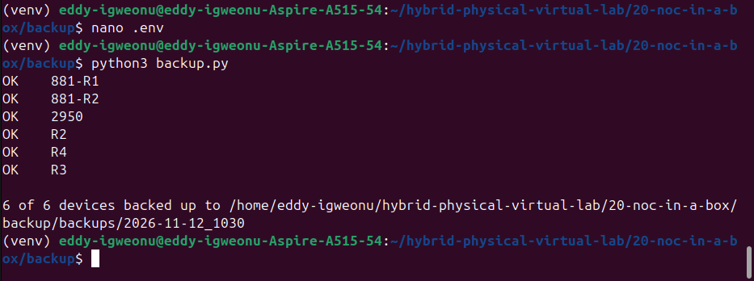

# Lab 20: NOC in a Box

This is the capstone for the repo. It ties most of the earlier labs together into one fictional company network and then runs it like a small NOC would: central logging, AAA, a monitoring dashboard, config backups, and a set of incident tickets worked from the dashboard.

The company has two sites. HQ and the branch are both physical Cisco 881 routers, connected across a virtual MPLS L3VPN carrier running in GNS3. An encrypted DMVPN tunnel rides on top of the carrier. HQ hosts the shared services (syslog, TACACS+, RADIUS, NTP) and the Grafana dashboard. The branch gets those services through the tunnel.

## Topology

| Device | Role | Key addresses |
|---|---|---|
| 881-R1 | HQ router, DMVPN hub | FE4 10.20.1.2/30, Vlan1 10.10.30.1, Vlan50 10.10.50.1, Tunnel0 172.16.100.1 |
| 881-R2 | Branch router, DMVPN spoke | FE4 10.20.2.2/30, Vlan1 10.20.50.1, Tunnel0 172.16.100.2 |
| R2 | Carrier PE, HQ side | Fa0/0 10.20.1.1 (VRF CORP), Fa0/1 core to R3 |
| R3 | Carrier P | core links to R2 and R4 |
| R4 | Carrier PE, branch side | Fa0/0 core to R3, Fa0/1 10.20.2.1 (VRF CORP) |
| 2950 | HQ access switch | mgmt 10.10.30.10 |
| Acer | Host for GNS3, logging, monitoring | 10.10.30.250 |
| tacacs-node | TACACS+ (tac_plus) | 10.10.30.244 |
| freeradius-node | RADIUS for 802.1X | 10.10.30.245 |

On R2, Fa0/0 faces HQ and Fa0/1 is the core link to R3. R4 is the other way round, with Fa0/0 as the core link and Fa0/1 facing the branch.

## What's in this folder

- `README.md` this file
- `INCIDENTS.md` the incident tickets, INC-01 to INC-09
- `noc-dashboard.json` the Grafana dashboard export (import it in Grafana under Dashboards, New, Import)
- `screenshots/` evidence for this README and the incident tickets
- `backup/` the Netmiko backup script and its requirements. Copy `.env.example` to `.env` and fill it in. The `.env` file and the `backups/` output folder are gitignored.

## How it's built

### The carrier

Three Dynamips c2691 routers in GNS3. OSPF area 0 and LDP run across the core, and the two PEs peer with MP-BGP vpnv4 between their loopbacks. Each PE puts its customer-facing interface in VRF CORP (RD and RT 65000:100) with `redistribute connected` under the VRF address family, so each site's WAN /30 shows up at the other PE.

The physical 881s reach the virtual carrier through GNS3 Cloud nodes bound to two USB Ethernet adapters on the Acer, one per site.

Once the carrier was up, 881-R1 could trace all the way to the branch WAN address. R3 shows up as hop 2 (more on that under things I learned).

The carrier routers don't send logs to the customer NOC. That's on purpose. In real life the carrier's routers belong to someone else, and when the core broke in INC-06 I had to prove it was the carrier from my own devices before I could look inside.

### The sites and the tunnel

Each 881 has a static route to the other site's WAN /30 through its PE. That's all the underlay needs. On top of that is DMVPN: Tunnel0 sourced from FE4, NHRP, and IKEv2 with a pre-shared key protecting it with IPsec in transport mode (AES-256, SHA-256). IKEv2 DPD was added after INC-06.

EIGRP 18 runs over the tunnel and carries the LAN routes for both sites. The LAN SVIs are passive so hellos only go over the tunnel (INC-01 is what happens when they don't).

HQ has two VLANs. Vlan1 is the services subnet where the Acer and the containers live, and Vlan50 is for HQ users. The trunk to the 2950 has to allow VLANs 1 and 1002 to 1005 or the 881's built-in switch won't bring it up properly. The branch is a single flat LAN on an SG105E.

### Shared services

**Syslog.** 881-R1, 881-R2 and the 2950 all log to rsyslog on the Acer, which writes one file per source under `/var/log/remote/`. I had a separate rsyslog container at first and dropped it. Logging straight to the host is simpler and there's one less thing to break.

**TACACS+.** tac_plus runs in a Docker container in GNS3. All three devices authenticate against it, with exec and level 15 command accounting turned on. There's an `admin` account at privilege 15 and a read-only `viewer` at privilege 1. Each device also has a local account as a fallback, but that only works when the server can't be reached (INC-03).

Getting accounting logs out of the container took some work. The container forwards tac_plus messages through its own rsyslog to the Acer, but a GNS3 Cloud node can't deliver frames to its own host. The fix was a host route on the container that sends traffic for 10.10.30.250 to 881-R1 first, which hairpins it back out to the Acer (881-R1 has `no ip redirects` on Vlan1 so this keeps working). All of that is baked into the image's entrypoint now, so the container comes back up after a stop and start with no manual steps.

**RADIUS.** freeradius runs in a second container for 802.1X on the 2950. It's set up but I haven't demoed it in this lab yet, see future work.

**NTP.** chrony on the Acer serves time. 881-R1 syncs from the Acer, and the 2950 and 881-R2 sync from 881-R1. Everything runs on UTC.

### Monitoring

The Grafana and Loki stack from lab 13 got reused. Promtail reads the per-device files in `/var/log/remote/` and labels them by job (`router`, `switch`, `tacacs`) and host. The stack still runs from the lab 13 folder, so the changes for this lab are there: the `network-devices` job in [`13-wan-monitoring/promtail/promtail-config.yaml`](../13-wan-monitoring/promtail/promtail-config.yaml) and the `/var/log/remote` mount in [`13-wan-monitoring/docker-compose.yml`](../13-wan-monitoring/docker-compose.yml).

Each 881 runs an EEM applet that logs "NOC heartbeat" every 5 minutes. The dashboard has a heartbeat tile per router that goes red if nothing has come in for 15 minutes. The 2950's IOS is too old for EEM, so it doesn't get one.

The dashboard (`noc-dashboard.json`) has:
- heartbeat tiles for both 881s
- failed logins
- critical events, severity 0 to 3
- log volume per host
- EIGRP neighbor changes
- log panels for interface and tunnel events, TACACS+ activity and critical events

Grafana shows times in my local time (NST, UTC-3:30) and the routers log in UTC, so the screenshots have both.

### Backups

`backup/backup.py` uses Netmiko to pull the running config from all six devices into a folder named with the UTC time of the run. The 881s are reached over SSH, the branch one through the tunnel. The 2950 is reached over Telnet because its IOS is too old for SSH, and the three carrier routers through their GNS3 console ports, which the script looks up through the GNS3 API. It logs in as the TACACS+ admin account, so backups show up in accounting too. It only exits 0 if all six succeed.

I ran it before every incident and at the end of every session. Running `diff -r` between two backup folders is my config drift check, and it's how I found the changed key in INC-07.

The 881s only offer SHA-1 key exchange, which current OpenSSH and paramiko refuse by default. My SSH config opts in to the legacy algorithms for just those hosts, and the script needs paramiko below version 4 for the same reason.

## Incidents

Full tickets are in [INCIDENTS.md](INCIDENTS.md). INC-01 to INC-04 came up on their own during the build. INC-05 to INC-08 were staged and worked from the dashboard as if I didn't know what I'd broken. INC-09 was real and happened after the lab was finished.

| ID | What happened | Type | Time to detect |
|---|---|---|---|
| INC-01 | EIGRP hellos on the wrong LAN | Real | |
| INC-02 | Duplex mismatch on the PE-CE links | Real | |
| INC-03 | Local login rejected while TACACS+ was up | Real | |
| INC-04 | TACACS+ server down, accounting gap | Real | |
| INC-05 | Branch WAN cable pulled | Staged | 1 min 45 sec |
| INC-06 | Carrier core link down | Staged | not measured (at most about 15 sec) |
| INC-07 | VPN down after a PSK change | Staged | 26 sec |
| INC-08 | Branch logs silently dropped by an ACL | Staged | about 14 min |
| INC-09 | Branch LAN unreachable, dashboard all green | Real | about 1 h 16 min |

Some of these taught me more than I planned. In INC-05 and INC-06 the original fault was the quick part. Most of the outage was the recovery failing afterwards, once because a USB adapter came back under a new interface index and once because of a stale IPsec session. INC-07 and INC-08 were both found with TACACS+ accounting, which told me who changed what and when. INC-08 shows the weak spot in the dashboard: when logs stop coming in nothing alerts, and I only found out once the 15 minute heartbeat window ran out. INC-09 is the opposite problem: the logs kept coming and the branch LAN was unreachable for over an hour, and only a failed backup run caught it.

## Things I learned

- A GNS3 Cloud node remembers the host's interface list from when it was created. If an adapter is missing or changes, the fix is a fresh Cloud node. This came up twice.
- A Cloud node bound to Wi-Fi fails silently because the Wi-Fi card won't bridge other MAC addresses.
- A Cloud node can't deliver frames to its own host. Hairpinning through the gateway router works.
- BGP stuck in Active while OSPF shows FULL adjacencies meant a loopback wasn't being advertised. The `!H` in a traceroute from R2 was the clue.
- The 881's built-in switch needs VLANs 1 and 1002 to 1005 in the trunk allowed list.
- TACACS+ fallback to local only happens when the server is unreachable, not when it rejects you.
- Modern SSH clients and paramiko refuse the 881's SHA-1 key exchange, so the legacy algorithms have to be allowed per host.
- USB NICs re-enumerate when they lose link, which breaks anything bound to them. Anything that needs to stay up should be on a built-in NIC.
- `%CRYPTO-4-RECVD_PKT_INV_SPI` after an outage means one side is still using an old IPsec session. Clear the session and turn on DPD.
- IOS saying "FREQ drift being measured" means NTP is working but not trusted yet. It takes 10 to 15 minutes.
- Promtail keeps its positions file inside the container by default, so recreating the container ships the whole log history again and Loki starts throwing 429s.
- `ip addr add` without a mask gives you a /32, and "File exists" on a route add means use `ip route replace`.
- R3, the P router, shows up as hop 2 when I traceroute across the carrier. IOS copies the IP TTL into the MPLS label by default, so the core is visible. A real carrier would usually hide it with `no mpls ip propagate-ttl`.
- The 2950's standard image has no EEM, no DAI and no `test aaa`, and dynamic VLAN assignment needs the enhanced image.
- A config change and the outage it causes can be far apart in time. In INC-07 the key change only broke the tunnel at the next rekey.
- In-band management, the backup job and branch logging all ride the tunnel, so when the tunnel breaks I lose sight of the branch at the same moment. The console was the only way in.
- The tacacs-node container stamps its log lines in UTC without a zone and the Acer labels them as local time, so those lines look 3h30 off.

## Known gaps and future work

- **Internet edge.** I planned an R5 for internet access with PE-CE routing or NAT, and dropped it to keep the scope sane.
- **DH group.** IKEv2 is still negotiating DH group 5, which is weak. It should be group 14 or higher.
- **Zone-based firewall.** I took FE4 out of its zone on both 881s during the build and haven't put it back. A self-zone policy that allows IKE and ESP is what's needed.
- **802.1X demo.** freeradius is running but I haven't tested Fa0/20 on the 2950 with a supplicant yet. Both USB adapters are in use, so it'll have to be the MacBook.
- **Promtail positions file.** It should be bind mounted so a container recreate doesn't resend everything.
- **Alerting.** Grafana alerts on EIGRP neighbor down and on log silence per host, instead of watching the dashboard.
- **Reachability checks.** A ping or IP SLA probe to each site's LAN, since a green heartbeat only proves the router can send (INC-09).
- **Scheduled backups.** Run backup.py from cron and alert when the diff isn't empty.
- **Config change logging.** `archive` with `log config` and `notify syslog` so config changes show up in Loki as well as in TACACS+ accounting.
- **tacacs-node timestamps.** Fix the timezone on the container's log lines.

Passwords, the TACACS+ key and the IKEv2 pre-shared key aren't in this repo.
