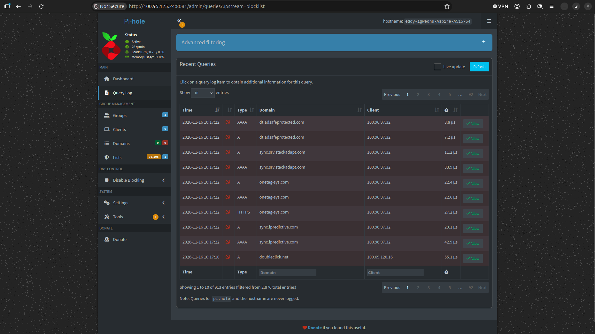
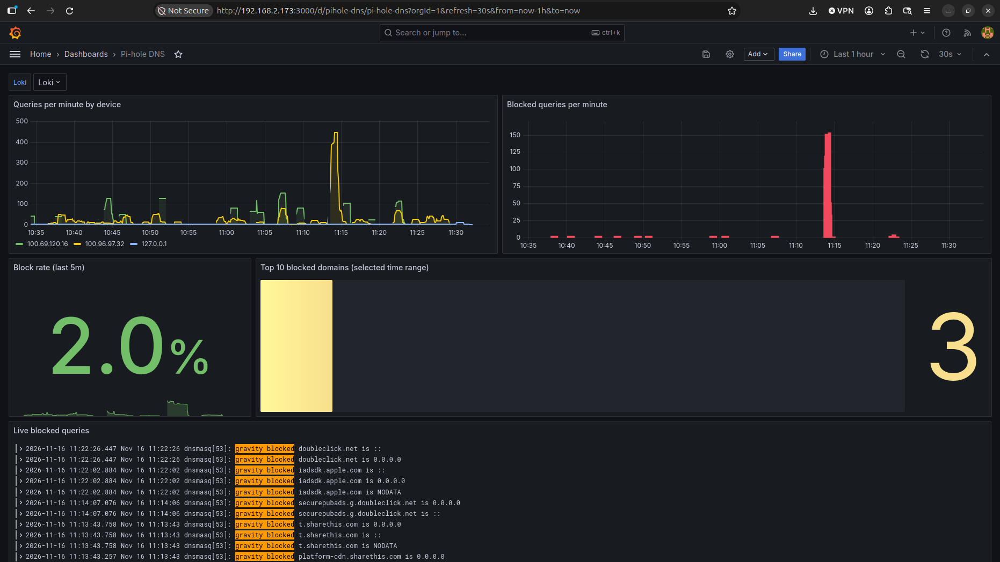
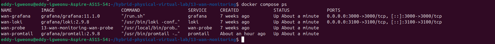
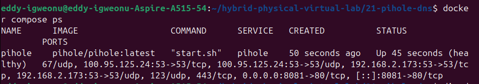

# 21 - Pi-hole DNS Filtering over Tailscale

Network-wide ad and tracker blocking for my own devices only, built with Pi-hole in Docker on the lab Acer. My MacBook and iPhone send their DNS to Pi-hole over Tailscale, so the filtering works at home and away from home without touching the rest of the house. Pi-hole's query log is shipped into the Loki and Grafana stack from lab 13, giving a per-device view of DNS activity and what is being blocked.

## Goals

- Block ads and trackers on my Mac and iPhone without changing DNS for anyone else on the home network
- Keep it working on any network, not just home Wi-Fi
- See every DNS query per device, and the blocked ones, in Grafana alongside my other lab logs

## Topology

```
MacBook (100.69.120.16) ─┐
                         ├── Tailscale tailnet ──> Acer tailscale0 (100.95.125.24:53)
iPhone  (100.96.97.32) ──┘                                   │
                                                        Pi-hole (Docker, host network)
                                                             │
                                          upstream DNS ◄─────┤
                                                             │ pihole.log
                                                        Promtail (lab 13) ──> Loki ──> Grafana
```

Tailscale's admin console has `100.95.125.24` set as the tailnet's custom nameserver with "Override DNS servers" turned on. Any device on my tailnet with Tailscale connected uses Pi-hole for DNS. The Acer itself is excluded with `tailscale set --accept-dns=false` so its own name resolution does not depend on the container it is hosting.

## Build

### Freeing port 53 on the host

Ubuntu's systemd-resolved listens on port 53 by default. I disabled its stub listener and pointed `/etc/resolv.conf` at the real resolver file so the host kept working:

```
sudo sed -i 's/#DNSStubListener=yes/DNSStubListener=no/' /etc/systemd/resolved.conf
sudo systemctl restart systemd-resolved
sudo ln -sf /run/systemd/resolve/resolv.conf /etc/resolv.conf
```

### Pi-hole container

Final `compose.yaml`:

```yaml
services:
  pihole:
    image: pihole/pihole:latest
    container_name: pihole
    network_mode: host
    environment:
      TZ: America/St_Johns
      FTLCONF_webserver_api_password: ${PIHOLE_PW}
      FTLCONF_dns_listeningMode: BIND
      FTLCONF_dns_interface: tailscale0
      FTLCONF_webserver_port: "8081"
      FTLCONF_ntp_ipv4_active: "false"
      FTLCONF_ntp_ipv6_active: "false"
      FTLCONF_ntp_sync_active: "false"
    volumes:
      - ./etc-pihole:/etc/pihole
      - ./logs:/var/log/pihole
    restart: unless-stopped
```

The admin password lives in a `.env` file that is gitignored along with `etc-pihole/` and `logs/`.

Key choices:

- **Host networking** so Pi-hole sees the real client IP of each query (see findings below)
- **BIND mode on `tailscale0`** so Pi-hole only answers on the tailnet and does not collide with libvirt's dnsmasq
- **Web UI on port 8081** to stay clear of anything else on the Acer
- **NTP server disabled** because Pi-hole v6 ships one and port 123 was already in use on the host

### Shipping logs to Loki

Two changes to the lab 13 stack in `13-wan-monitoring`.

Promtail gets the Pi-hole log folder mounted read-only in `docker-compose.yml`:

```yaml
      - ../21-pihole-dns/logs:/var/log/pihole:ro
```

And a new scrape job in `promtail/promtail-config.yaml`:

```yaml
  - job_name: pihole
    static_configs:
      - targets: [localhost]
        labels:
          job: pihole
          __path__: /var/log/pihole/pihole.log
```

### Grafana dashboard

The dashboard is in `grafana/pihole-dashboard.json` and can be imported directly. It uses a data source variable so it picks up whatever Loki data source exists. Panels and their LogQL:

| Panel | Query |
|---|---|
| Queries per minute by device | ``sum by (client) (count_over_time({job="pihole"} \|= "query[" \| regexp `from (?P<client>\S+)` [1m]))`` |
| Blocked queries per minute | `sum(count_over_time({job="pihole"} \|= "gravity blocked" [1m]))` |
| Block rate (last 5m) | blocked count over 5m divided by total queries over 5m, times 100 |
| Top 10 blocked domains | ``topk(10, sum by (domain) (count_over_time({job="pihole"} \|= "gravity blocked" \| regexp `gravity blocked (?P<domain>\S+)` [$__range])))`` (instant query) |
| Live blocked queries | `{job="pihole"} \|= "gravity blocked"` |

## Verification

From the Acer, querying Pi-hole directly:

```
$ dig doubleclick.net @100.95.125.24 +short
0.0.0.0
```

From the Mac with Tailscale connected and no manual DNS set:

```
$ dig doubleclick.net +short
0.0.0.0
```

In Pi-hole's query log, blocked lookups show up tagged with each device's own Tailscale IP: the iPhone's ad and tracker requests (stackadapt, onetag, ipredictive, adsafeprotected) from `100.96.97.32` and the `doubleclick.net` test from the Mac at `100.69.120.16`.

Loki confirmed ingestion through its HTTP API:

```
curl -G -s http://localhost:3100/loki/api/v1/query_range \
  --data-urlencode 'query={job="pihole"}' --data-urlencode 'limit=5'
```

## Findings

**The Bell GigaHub will not hand out a custom DNS server.** Its DHCP always gives clients the hub's own IP as DNS, and community reports show that pointing it at a local Pi-hole can break that host's connection to the hub. Covering the whole house would mean disabling the GigaHub's DHCP and letting Pi-hole run DHCP for everyone, which makes the Acer a single point of failure for the household. That is out of scope for a personal setup.

**The TP-Link range extender rewrites client MAC addresses.** My Acer and Mac usually connect through the extender, which bridges onto the same subnet but presents its own MAC to the hub. That makes DHCP reservations on the GigaHub unreliable for anything behind the extender. Using the Acer's Tailscale IP as the DNS address removes the dependency on the house LAN entirely.

**libvirt's dnsmasq already holds port 53.** The first start failed with `address already in use` on `0.0.0.0:53`. `ss -tulpn` showed libvirt's dnsmasq bound to `192.168.122.1:53` for the default KVM NAT network used by my AD lab VMs. Binding Pi-hole to specific addresses (and later to `tailscale0` only) avoided the conflict without touching libvirt.

**Docker bridge networking hid every client behind the bridge gateway.** With published ports, every query in Pi-hole's log came from `172.19.0.1`, the Docker bridge gateway, so the Mac and iPhone were indistinguishable. Switching to `network_mode: host` with `listeningMode: BIND` on `tailscale0` let Pi-hole see the real source address of each device.

**Pi-hole refuses queries for its first minute.** Testing right after `docker compose up` returned timeouts in bridge mode and `connection refused` in host mode. Both cleared once `docker compose ps` showed the container as healthy, after it had finished loading its blocklists.

**Pi-hole v6 includes an NTP server.** In host mode it tried to bind `0.0.0.0:123`, found it taken, and raised a diagnosis warning. I turned off its NTP server and time sync since the Acer already handles time.

**Promtail ingests an existing log file all at once.** When the new scrape job started, Promtail read the whole existing `pihole.log` in one pass and stamped every line with the ingestion time, which produced a single large spike on the graphs. It only happens once, but it is worth knowing before trusting the first few minutes of data on a new log source.

## Limitations

- The iPhone only gets filtering while the Tailscale VPN is switched on
- iCloud Private Relay had to be turned off, since it can route Safari's DNS around the configured resolver
- If the Acer is off, my devices lose DNS while Tailscale is connected. A second Pi-hole on another tailnet node would fix that.
- This lab depends on the lab 13 Loki and Grafana stack for its logging

## Screenshots

Query log showing blocked requests tagged by each device's Tailscale IP:



Grafana dashboard fed from Loki:



Container running in host network mode (no published ports):



Earlier bridge-mode run, before the switch to host networking:



## Files

```
21-pihole-dns/
├── compose.yaml
├── .gitignore
├── grafana/
│   └── pihole-dashboard.json
├── images/
└── README.md
```
