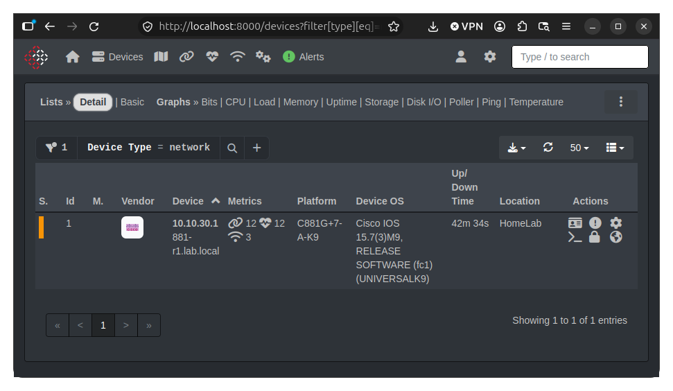
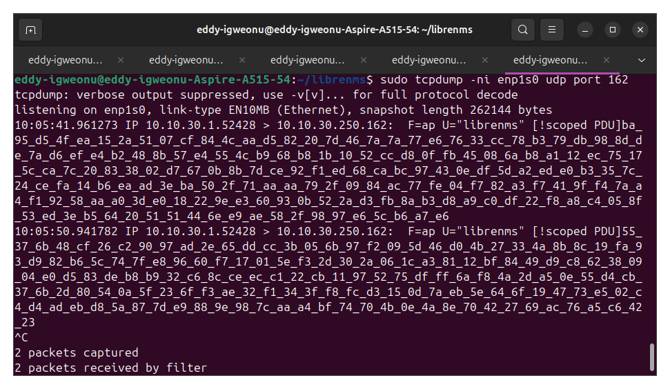
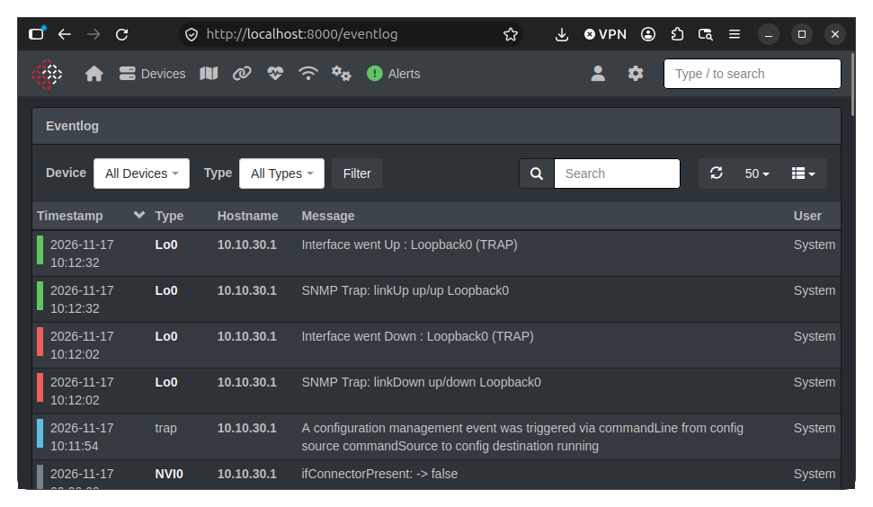
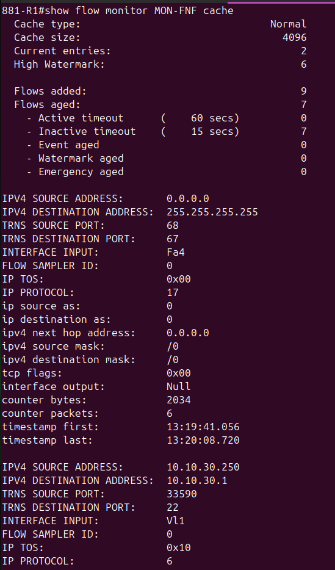
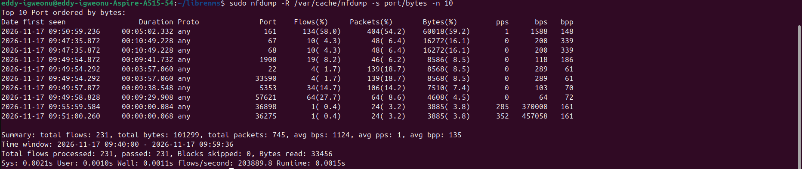
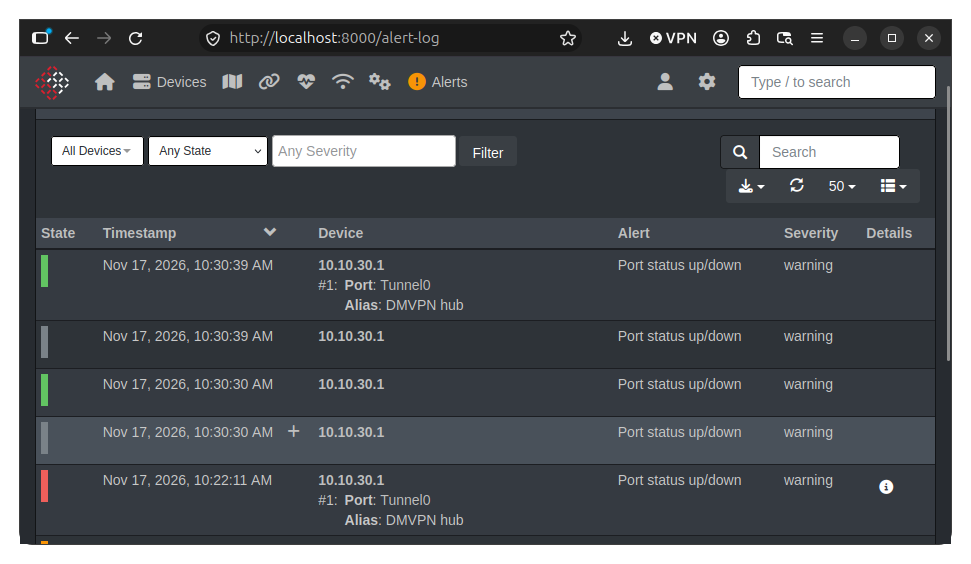

# 22 - SNMP and NetFlow Monitoring (LibreNMS + nfdump)

## Overview

Every lab before this one sent syslog or AAA accounting somewhere, but nothing in the network was being polled or watched for state changes. Most NOCs still run on SNMP polling, SNMP traps and flow data, so this lab adds that layer on top of the lab 20 network.

The physical 881-R1 is monitored three ways:

- SNMPv3 polling (authPriv, SHA + AES-128) into LibreNMS for interface, CPU, memory and uptime graphs
- SNMPv3 traps for link and config changes, decoded by LibreNMS's snmptrapd container
- Flexible NetFlow v9 exported to an nfdump collector for top talker analysis

On top of that, LibreNMS alert rules were tested against a real cable pull, with the alert firing and then clearing on its own.

## Topology

| Role | Device | Address |
|---|---|---|
| Monitored router | 881-R1 (C881G+7-A-K9, IOS 15.7(3)M9) | Vlan1 10.10.30.1 |
| Collector | Acer (Ubuntu 24.04), enp1s0 via the 2950 | 10.10.30.250 |
| Mgmt switch | Cisco 2950 | Vlan1 10.10.30.10 |

Both the router and the collector sit on the same 10.10.30.0/24 segment through the physical 2950, so polling, traps and flow export all stay on one flat management network.

## Collector stack

LibreNMS runs as a plain Docker Compose stack on the Acer host, built from the official `librenms/docker` example (LibreNMS, MariaDB, Redis, dispatcher, snmptrapd). I ran it on the host rather than as GNS3 Docker nodes, which follows the lab 13 approach and avoids the GNS3 console proxy and lost-IP problems from earlier labs.

I removed the example's syslog-ng sidecar before starting the stack because it publishes UDP 514, which the Acer's rsyslog already uses for lab 20's device logs:

```
sed -i '/^  syslogng:/,/^  snmptrapd:/{/^  snmptrapd:/!d}' compose.yml
docker compose config --services
docker compose up -d
```

NetFlow is collected by `nfcapd` from Ubuntu's `nfdump` package, which runs as a system service writing 5 minute capture files to `/var/cache/nfdump`.

## Router configuration (881-R1)

### SNMPv3

```
ip access-list standard SNMP-MGMT
 permit host 10.10.30.250
snmp-server view ALLVIEW iso included
snmp-server group NOC-RO v3 priv read ALLVIEW access SNMP-MGMT
snmp-server user librenms NOC-RO v3 auth sha <AUTH_PASS> priv aes 128 <PRIV_PASS>
snmp-server ifindex persist
snmp-server location HomeLab
snmp-server contact Eddy
snmp-server enable traps snmp linkdown linkup coldstart
snmp-server enable traps config
snmp-server enable traps hsrp
snmp-server host 10.10.30.250 version 3 priv librenms
snmp-server trap-source Vlan1
```

The ACL limits SNMP access to the collector only, and `ifindex persist` keeps interface indexes stable across reboots so LibreNMS graphs don't get mixed up.

### Flexible NetFlow

```
flow exporter EXP-ACER
 destination 10.10.30.250
 source Vlan1
 transport udp 2055
flow monitor MON-FNF
 exporter EXP-ACER
 record netflow ipv4 original-input
 cache timeout active 60
interface FastEthernet4
 ip flow monitor MON-FNF input
interface Vlan1
 ip flow monitor MON-FNF input
interface Tunnel0
 ip flow monitor MON-FNF input
```

NetFlow v9 is the default export protocol, so IOS doesn't show `export-protocol netflow-v9` in the running config.

## Trap receiver configuration

SNMPv3 traps are sent by the router as the authoritative engine, so the receiver needs the router's engine ID as well as the user credentials. I got the engine ID from `show snmp engineID` on R1 and added the trap settings to `librenms.env`:

```
SNMP_USER=librenms
SNMP_AUTH=<AUTH_PASS>
SNMP_PRIV=<PRIV_PASS>
SNMP_AUTH_PROTO=SHA
SNMP_PRIV_PROTO=AES
SNMP_SECURITY_LEVEL=priv
SNMP_ENGINEID=<R1_ENGINE_ID>
```

After `docker compose up -d`, I confirmed the generated config inside the container:

```
docker compose exec snmptrapd grep createUser /etc/snmp/snmptrapd.conf
```

## Verification

### Polling

I tested SNMPv3 from the collector before touching the LibreNMS UI, so a failure would point clearly at either the network or the app:

```
snmpget -v3 -l authPriv -u librenms -a SHA -A '<AUTH_PASS>' -x AES -X '<PRIV_PASS>' 10.10.30.1 1.3.6.1.2.1.1.1.0
```

This returned the full IOS version string. I used the numeric OID because Ubuntu's SNMP tools don't load MIB names by default.

After adding the device, LibreNMS discovered R1 as a C881G+7-A-K9 running IOS 15.7(3)M9, with 12 ports and 12 health sensors.



### Traps

Bouncing Loopback0 sent linkDown and linkUp traps to the collector. In tcpdump they show `F=ap` (authenticated and encrypted) and an unreadable payload, since tcpdump doesn't have the keys:



LibreNMS decoded the same traps and logged them in R1's Eventlog:



### NetFlow

The flow cache on R1 showed flows being created and aged out for export:

```
show flow monitor MON-FNF cache
```



Top talkers from the collector:

```
sudo nfdump -R /var/cache/nfdump -s ip/bytes -n 10
```



Over about 15 minutes nfdump processed 114 flows. What showed up:

- **10.10.30.250 and 10.10.30.1** made up about 75% of bytes. This was SNMP polling from LibreNMS plus my SSH session, so on a quiet LAN the monitoring system was the biggest talker.
- **0.0.0.0 to 255.255.255.255 on UDP 67/68** arrived on FE4, about 15% of bytes. With the lab 20 GNS3 project shut down, the far end of the DMVPN underlay cable was sending DHCP requests, most likely an Acer USB adapter with no IPv4 address.
- **10.10.20.10 to 239.255.255.250 and 224.0.0.251** was SSDP and mDNS from the Acer's second address on the lab segment. Desktop service discovery was leaking onto the lab LAN from the monitoring host itself.
- **10.10.30.10**, the 2950's SVI, had a handful of small flows.

### Alerting

I added four rules from LibreNMS's built-in collection: Devices up/down, Port status up/down, Device rebooted, and Processor usage over 85%.

The port rule only fires when a port is operationally down while still admin up, so an admin `shutdown` doesn't trigger it. That's intended, since a shutdown is a deliberate change. To test properly I pulled the FE4 cable on R1.

The alert fired at 10:22:11 and recovered at 10:30:39 after the cable went back in:



The alert was raised on Tunnel0 (DMVPN hub). FE4 is the tunnel's underlay, so when the cable came out, the tunnel lost its source interface and its route to the peer, and its line protocol dropped as well. One physical fault showed up as an alert on a logical interface that depends on it, which is the kind of symptom versus root cause tracing a NOC has to do.

## Findings and troubleshooting

1. **The old management SVI was gone.** `snmp-server trap-source vlan 50` was rejected even though `?` listed Vlan as an option. IOS rejects the whole interface name when the interface doesn't exist, which is why the caret pointed at `vlan` rather than the number. After the lab 20 rebuild, R1's management address had moved to Vlan1 (10.10.30.1), so the collector target changed to 10.10.30.250 on the same segment.

2. **SNMPv3 users never appear in the running config.** After entering `snmp-server user`, the line isn't in `show run`. `show snmp user` and `show snmp group` are the way to verify it.

3. **Traps arrived but were silently dropped.** tcpdump showed traps reaching UDP 162, but nothing appeared in LibreNMS and the snmptrapd log showed no errors. The trap container was still running with its default user and engine ID. Once it had R1's engine ID and credentials, the same traps were decoded and logged.

4. **A second collector was already listening.** Installing `nfdump` on Ubuntu also starts an nfcapd service on UDP 2055 writing to `/var/cache/nfdump`. My manually started nfcapd pointed at `~/netflow` never received anything. `ss -ulpn` showed the system service owned the port, so I used that collector instead.

5. **Monitoring only the WAN interface showed almost nothing.** NetFlow was first applied only to FE4, the DMVPN underlay. With the carrier project in GNS3 shut down, FE4 carried barely any traffic, and when it is up it only carries ESP between the two tunnel endpoints. Adding the monitor to Vlan1 and Tunnel0 gave useful data: Vlan1 shows LAN hosts, and Tunnel0 shows the decrypted traffic inside the VPN.

## Known gaps and next steps

- **881-R2 isn't monitored yet.** Its only path from the collector runs across the MPLS carrier and DMVPN in the lab 20 GNS3 project. Polling the branch over the WAN is the more realistic setup, since losing the tunnel would then also show up as the branch going down.
- **Traps from a second router need a custom snmptrapd.conf.** The LibreNMS container's environment variables only support one engine ID, so R2 will need its own `createUser` line in a mounted config file.
- **The 2950 hasn't been added.** Its image has no crypto support, so SNMPv3 authNoPriv is the best it can do.
- **An HSRP state change alert** would catch failovers where nothing actually goes down. This needs R2 in place.
- **There's no alert transport yet.** Alerts only show in the web UI. Sending them to a ticketing system by webhook is planned for the next lab.
- **A Wireshark capture comparing SNMPv2c (community string in plaintext) with SNMPv3** would make the security point clearer.

## Files

Credentials in `.env` and `librenms.env` are kept out of the repo. The values above are placeholders.
